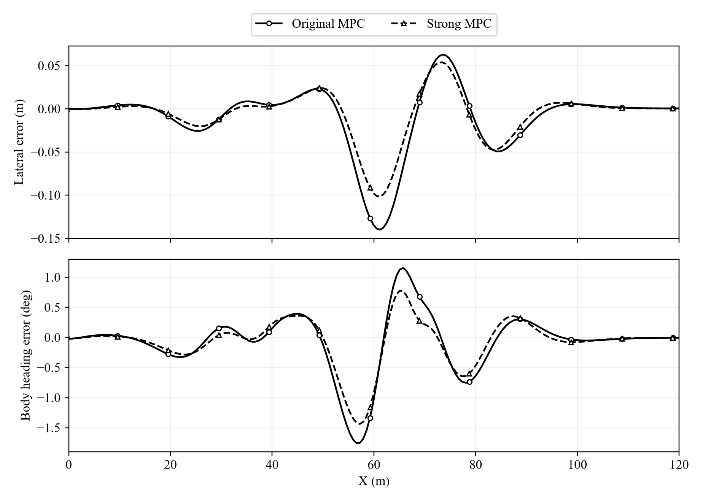

# 60km/h、mu=0.8训练工况验收

后续状态：80/.8已验收加入train，三速度数据准备与真实切换结果见[80km/h报告](CarSim_80kmh_Training_Case.md)。下文保留2b820a7阶段的60工况结果及当时准备状态，指标未改变。

基于5cd28d8，2026-11-16。已核验当前原生60km/h工况、冻结独立快照并完成双MPC预检。通过后加入train，原65/75开发验证及70/.6预留测试归属不变。没有训练、resume、重新选模或改变MPC、车辆、奖励、动作及网络。

## 来源与契约

原生入口为 `D:\Program Files (x86)\CarSim2024_Date\simfile.sim`，其Parsfile为 `D:\Program Files (x86)\CarSim2024_Date\Results\Run_6cb07365-85a3-4a3b-95f9-c5c844687601\Run_all.par`。实际SPEED_TARGET_CONSTANT=60、MU_ROAD_CONSTANT=0.8；与冻结70/.8比较，物理内容唯一变化是速度70→60。

私有文件：

```text
C:\Users\fengchengmin\Desktop\JQRKZ\DRL-MPC\runs\training_case_60_mu08_20261116_212330\source_60_mu08\simfile.sim
C:\Users\fengchengmin\Desktop\JQRKZ\DRL-MPC\runs\training_case_60_mu08_20261116_212330\source_60_mu08\Run_all.par
```

完整Parsfile SHA256为 `574c0ee5f28994e7c6b8ba6d2ba851558b0147a8d8e9653a86f41c3eeebfb9ea`，私有Simfile SHA256为 `1bd306ba05267c7b382e592560033f4cd086beb5b7463039abd6ee7397d25096`，物理签名为 `c3795eb276ef9ab53a0f10c0d4ff95f82a566bd0733c3f2a3056044b922c8792`，与现有四源均不同。

车辆/轮胎、I/O和原0–120m LTARG哈希与70/.8完全一致。原生echo确认IMP_STEER_L1/R1为REPLACE、deg，20输出顺序不变，速度60、mu=.8。控制0.04s、决策0.08s；反馈仍用SI单位。原70/65/75及低附着快照再次按完整文件哈希核验，原模型及配置链未变。[完整契约证据](archive/training60_20261116_acceptance.json)保存全部路径和哈希。

## 真实固定MPC结果

| 指标 | 原始MPC | 强MPC |
|---|---:|---:|
| 横向RMSE m | 0.038857156 | 0.029035128 |
| 车身航向RMSE ° | 0.493922995 | 0.387635240 |
| 横向峰值 m | 0.139995162 | 0.101620791 |
| 航向峰值 ° | 1.755533743 | 1.437150389 |
| 峰值Ay m/s² | 6.242849645 | 6.226817074 |
| 峰值Beta ° | 0.564493089 | 0.528516209 |
| 实际终点X m | 120.006196648 | 120.004871673 |
| QP失败 / 完赛 / 稳定性门槛 | 0 / 是 / 通过 | 0 / 是 / 通过 |

门槛保持Ay≤0.85g、|Beta|≤5°、QP=0、完整结束。原始与强MPC权重未变。完整[原始指标CSV](archive/training60_20261116_metrics.csv)包含航迹角RMSE和其他传感指标。这里只评价固定MPC，没有产生新的DRL训练或60km/h策略性能结果。



## 实际训练源切换检查

正式清单当前按顺序为train=[70/.8,60/.8]、validation=[65/.8,75/.8]、test=[70/.6]，保持旧train的70为索引0。共5份真实源、10组双基线预检全部通过。

以清单train作为同一CarSimMPCEnv的scenario_pool，seed42真实运行70→60→60→70；每回合先完整结束，再关闭旧桥接并启动新子进程，实际初始车速与所选源一致，20维观测有限。强MPC零动作决策数为79/92/92/79，总342；70源158步，60源184步。四次回放均完赛、QP=0并复现对应强MPC指标。

该实验是无学习器、无经验池、无梯度更新的接口检查，验证多训练源能真实切换，不代表已经完成多工况DRL训练。保留uniform_episode_v1等概率回合采样；同回合机会不等于同决策步数，后续实验继续记录每工况实际暴露量。

formal_compare的多训练速度门槛现已满足，当前唯一代码阻塞为缺少验证选出的超参数配置锁，ready=false、executed=false。80/.8仍为原60/70/80三速度计划中的待生成源，不能宣称三速度准备已完成；正式预算、选参方案及模型锁仍需冻结。本轮不启动15组或其他新训练。

## 验收与产物

Release构建、CTest 1/1、pytest 69/69通过；60km/h全程零动作一致性183控制步通过。未修改控制/训练代码，未改原模型、历史结果及MATLAB工程。

完整输出 `runs/training_case_60_mu08_20261116_212330/`：source_60_mu08、source_verification、物理差异、candidate_sets及原集合备份、preflight的10组回放、training60_metrics、acceptance、neutral_parity、train_switch_probe及其结果、formal_plan、PNG/PDF误差图。已验收源写入 [real_scenario_sets.local.json](../configs/real_scenario_sets.local.json)，所有条目均为真实绝对路径。

复现命令（项目根PowerShell，换用不存在的新输出目录，不启动训练）：

```powershell
$env:OMP_NUM_THREADS='1'
$env:MKL_NUM_THREADS='1'
$env:PYTHONDONTWRITEBYTECODE='1'
uv run --no-project --with-requirements python/requirements.txt python python/scenario_preflight.py --scenario-set configs/real_scenario_sets.local.json --out runs/five_cases_preflight_NEW
$case60 = (Get-Content configs/real_scenario_sets.local.json -Raw | ConvertFrom-Json).train[1]
uv run --no-project --with-requirements python/requirements.txt python python/parity.py --config configs/strong_weights3.ini --simfile $case60 --blocks 200 --out runs/train60_parity_NEW
uv run --no-project --with-requirements python/requirements.txt python python/formal_compare.py --profile weights3 --scenario-set configs/real_scenario_sets.local.json --train-config configs/rl_training_pilot.ini --total-decisions 7900 --baseline-proof runs/five_cases_preflight_NEW/baseline_proof.json --out runs/formal_precheck_NEW
```
