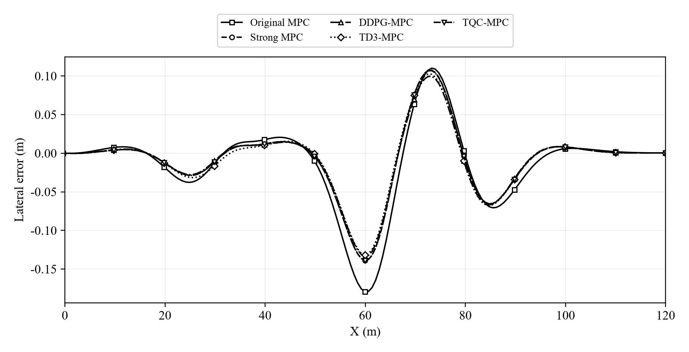
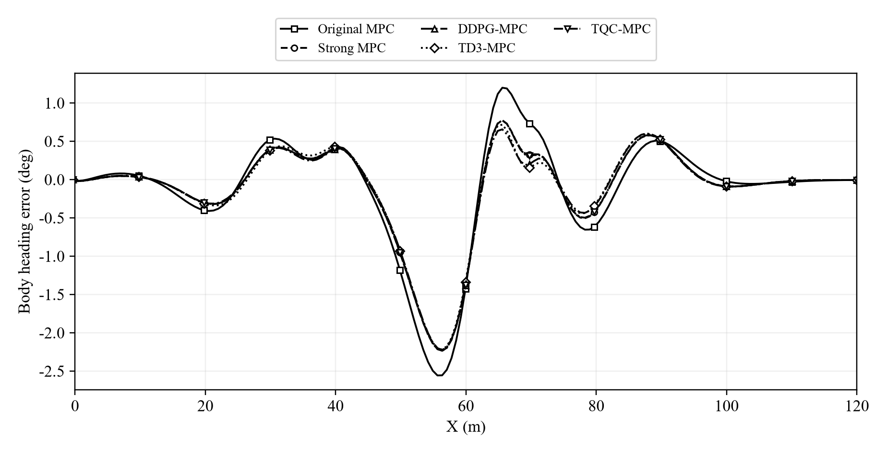
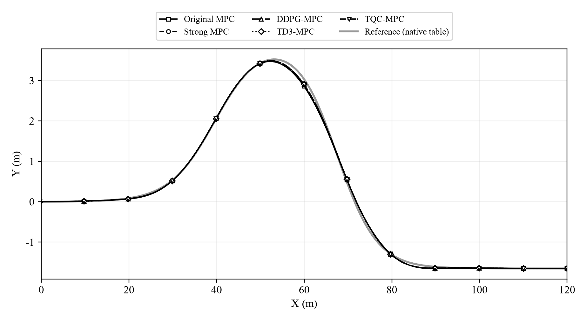
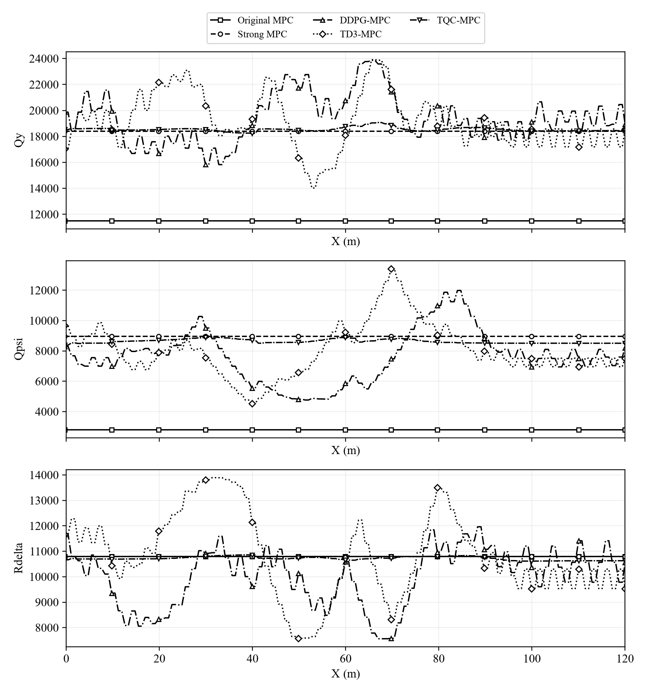
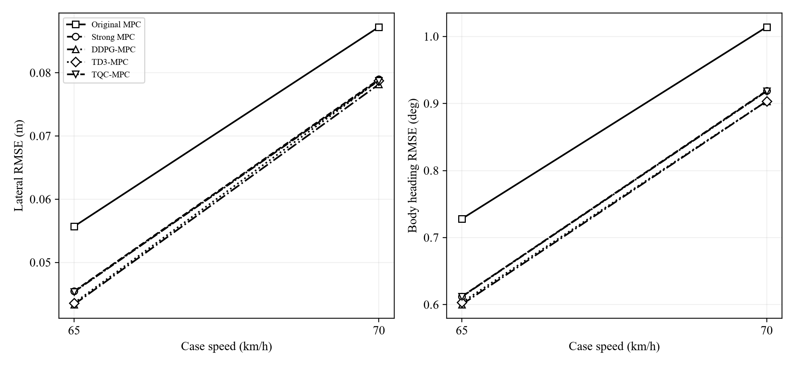

# 65km/h、mu=0.8真实CarSim跨速度开发验证

基于116a15e，2026-11-16执行。已定位用户在CarSim 2024.1原生生成的新工况，并完成双MPC预检、两套全程零动作一致性和三个冻结最佳检查点的真实闭环回放。**没有训练、resume、重新选模、调MPC/奖励/动作参数，也没有修改车辆、原生工况或MATLAB工程。65km/h仅为开发验证，最终test为空。**

## 工况来源与兼容性

本轮检查目录：`D:\Program Files (x86)\CarSim2024_Date`、当前项目、历史C++工作区 `C:\Users\fengchengmin\Desktop\C++\myfcm\MPC_DoubleLaneChange_Tunable_VisualStudio\MPC_DoubleLaneChange_Tunable`。列出10056份Simfile，跳过2909个回合副本，解析7140份静态来源，7份旧引用不可读。65km/h去重候选4份：当前原生工况通过；其余为旧mu=0.4或变化附着工况，车辆、I/O和参考轨迹不匹配，没有用于仿真。完整筛选证据在本轮runs的 `discovery.json`。

实际选中：

```text
Simfile: D:\Program Files (x86)\CarSim2024_Date\simfile.sim
Parsfile: D:\Program Files (x86)\CarSim2024_Date\Results\Run_6cb07365-85a3-4a3b-95f9-c5c844687601\Run_all.par
Run Control: Baseline / Quick Start Guide Example
Procedure: steer001
原生修改时间: 2026-11-16 19:48:22
SPEED_TARGET_CONSTANT 65
MU_ROAD_CONSTANT 0.8
```

文件内容而非目录名确认速度/附着。与此前冻结70km/h源逐行比较非注释、非来源标签的数值内容，**唯一变化是SPEED_TARGET_CONSTANT从70变65**；车辆、轮胎、转向模式、道路、附着及LTARG保持相同。

| 契约 | 结果 |
|---|---|
| 车辆与轮胎数据块 | SHA256一致：`094c90788cf2e417ca8746934c44442e11ce683f817607dbd4b4c444e357fb0c` |
| I/O数据块 | SHA256一致：`c37e373b01faa9694ec13ec8c69df9360f5e2a73c9d899e4ef9698019fbb6490` |
| LTARG原表 | SHA256一致：`fab48468ae2759465ee3a36cc8275f5273d81dbbad4eb7b56715d8368e73921b` |
| LTARG数值规范化 | SHA256一致：`b1b923ea798c20a2d5d8ca501abd8efba44c9921fdb7dcc0de8f88bb7216389c` |
| 参考区间/最大表曲率 | 0–120m；有限差分最大绝对曲率0.027043639m⁻¹，与70km/h一致 |
| 65物理签名 | `34db60360e2714ac115dc734d7e701a8a2b986f9b42fd7f58edbb995d3b083dd` |
| 70物理签名 | `4b2833a3a0ee9d26069398a2de361ed49c293399e1ff9a67543336fc70687aa7`，与65不同 |
| 控制/决策周期 | 0.04s / 0.08s，末决策仅1个控制步 |

新原生Simfile/Parsfile SHA256分别为 `9b2f81682b4e350e69d2c820923265faabcfc5f3a9157756d00c884716f3ab6e` / `4f8836368263906abe771c65100d69ef80425ed3d8df32189ea9665e293aa0bc`。用现有snapshot工具复制完整原生Parsfile，仅重定向私有Simfile的INPUT路径，不拼接或修改物理工况。私有Simfile因INPUT路径不同而具有独立文件哈希，记录于[契约证据](archive/carsim_65kmh_20261116_compatibility.json)。运行前后原生文件哈希一致。

原生Solver echo确认两路输入 `IMP_STEER_L1,IMP_STEER_R1`、REPLACE、deg；20输出顺序为 `Xcg_TM,Ycg_TM,Vx,Vy,Yaw,AVz,Ax,Ay,Steer_L1,Steer_R1,Beta,Rho_Road,AlphL_L1,AlphL_R1,AlphL_L2,AlphL_R2,Fy_L1,Fy_R1,Fy_L2,Fy_R2`。echo将名称转为大写，按相同关键词核对。9次评价回放均逐项检查通过。echo显示Vx为km/h、Yaw/Beta/轮角为deg、Ay为g；C++仍通过 `vs_get_var_ptr` 读取SI值，转角输入保留弧度到度增益。实测平均纵向速度约64.939km/h，与65目标一致。

新增 [real_cases_65.local.json](../configs/real_cases_65.local.json) 使用实际绝对路径：train为此前DDPG实验冻结的70km/h源，validation为本轮 `source_65/simfile.sim` 私有快照，test=[]。当前Browser的默认Simfile已是65，复现旧70实验必须显式使用冻结70路径，不能把可变Browser入口当作70来源。

## 双MPC预检与冻结模型

直接运行原有 `scenario_preflight.py`，没有覆盖控制权重：原始40/13/11500/2800/10800；强36/13/18400/8960/10800，均保持 `track_course=true`。65km/h结果：

| 基线 | 横向RMSE m | 航向RMSE ° | 横向峰值 m | 航向峰值 ° | 峰值Ay m/s² | 峰值Beta ° | 终点X m | QP失败/完赛/安全 |
|---|---:|---:|---:|---:|---:|---:|---:|---|
| 原始MPC | 0.055693219 | 0.727976850 | 0.179320066 | 2.556442817 | 6.785035381 | 1.369804521 | 120.002358 | 0 / 是 / 是 |
| 强MPC | 0.045448029 | 0.612186098 | 0.138839627 | 2.234185119 | 6.778812732 | 1.321005534 | 120.002299 | 0 / 是 / 是 |

安全门槛未变：完整结束、QP=0、峰值|Ay|≤0.85g=8.3356525m/s²、|Beta|≤5°。预检还按集合回放70训练来源并复现原始/强MPC指标。整体 `baseline_proof.json.ready=false` **仅因test为空**，65两套基线均通过后才启动策略回放。[预检CSV](archive/carsim_65kmh_20261116_preflight.csv)保留四行原始记录。

原锁 [next_stage_20261116_locks.json](archive/next_stage_20261116_locks.json) 未修改，三个 `best_legal_model.zip` 均与指定周期检查点逐字节哈希相同：

| 算法 | 固定检查点 | SHA256 |
|---|---:|---|
| DDPG | 2370步 | `b5fe60505e9adbdb0de3bca64e7dd9859823dd58b64ff0db0e0905b9f9a5c095` |
| TD3 | 6320步 | `ea445194ca595e01cadabceae8144a249b88f1805ae344e18931c38fd672474b` |
| TQC | 4740步 | `7d2cb8b2878c0da553890ace245d2d5c50dbef0cdfbbf0b68150f96925811cf4` |

三者训练来源均为70km/h、mu=0.8、seed42、各7900决策；保持三维 `[Qy,Qpsi,Rdelta]`、Np36、20维road_preview_joint、联合奖励、continuous_weights和1.08限速。评价前后验证模型、指定checkpoint、配置全继承链SHA256，以及命名动作契约；实际桥接Np归一化请求恒0、执行Np恒36。未调用任何训练或选模入口，未加载final模型。

## 65km/h统一结果

通过现有 `evaluate_dual.py --split validation` 执行，全部为真实CarSim在线闭环。`e_heading=wrap(psi-psi_ref)`，`e_course=wrap(psi+beta-psi_ref)`；ey为Y−Yref。角度指标转为度。RMSE与既有70报告一样使用完整原生控制后时间样本，不对指标按X重采样；曲线横轴采用各自真实X。

| 控制器 | 横向RMSE m | 航向RMSE ° | 航迹角RMSE ° | 横向峰值 m | 航向峰值 ° | 相对65强MPC横向/航向改善 |
|---|---:|---:|---:|---:|---:|---|
| 原始MPC | 0.055693219 | 0.727976850 | 0.629415128 | 0.179320066 | 2.556442817 | — |
| 强MPC | 0.045448029 | 0.612186098 | 0.550199293 | 0.138839627 | 2.234185119 | 0 / 0 |
| DDPG-MPC | 0.043351679 | 0.600292330 | 0.529952737 | 0.133715424 | 2.223297978 | **4.6126% / 1.9428%** |
| TD3-MPC | 0.043574026 | 0.603292254 | 0.534982170 | 0.131821528 | 2.218654455 | **4.1234% / 1.4528%** |
| TQC-MPC | 0.045342648 | 0.611743942 | 0.549037950 | 0.138798964 | 2.234591312 | **0.2319% / 0.0722%** |

改善率采用 `100*(1-RMSE_policy/RMSE_strong65)`。三者本次均满足合法性及严格双RMSE降低，没有相对65强MPC的横向退化。TQC航向峰值却略增约0.000406°，不能把双RMSE改善说成所有指标全面优越。

| 控制器 | 峰值Ay m/s² | 峰值Beta ° | 转向指令速率RMS °/s | MPC均值/p95 ms | 策略推理均值/p95 ms | QP失败/完赛 |
|---|---:|---:|---:|---|---|---|
| 原始MPC | 6.785035 | 1.369805 | 6.822696 | 0.229315 / 0.267920 | 不适用 | 0 / 是 |
| 强MPC | 6.778813 | 1.321006 | 7.060198 | 0.214025 / 0.255680 | 不适用 | 0 / 是 |
| DDPG-MPC | 6.794222 | 1.329436 | 7.307755 | 0.236992 / 0.351720 | 0.501146 / 0.685920 | 0 / 是 |
| TD3-MPC | 6.785170 | 1.313793 | 7.377575 | 0.253196 / 0.387780 | 0.525799 / 0.694640 | 0 / 是 |
| TQC-MPC | 6.778599 | 1.322396 | 7.090773 | 0.239664 / 0.344420 | 0.661576 / 0.906160 | 0 / 是 |

三策略终点分别120.008780/120.007365/120.002170m，均169控制步、85策略决策。安全门槛全部通过；转向速率RMS均略高于强MPC，不能忽略跟踪与平顺性的权衡。MPC计时包含该次控制计算；策略计时为CPU确定性predict，不含CarSim积分、IPC、进程启动及日志。本机单次时延不是硬实时或算法计算排名的证明。

评价原始CSV含每算法配套的一对固定基线，共9行，全部保留。统一表将完全相同的重复基线取第一次，时延也取同一次，得到5行；任何物理指标或状态不一致均拒绝去重，不选择更有利的重复回放。统一[完整CSV](archive/carsim_65kmh_20261116_metrics.csv)包含训练来源、速度、附着、模型哈希、所有指标及70对照；本地同内容保存为本轮runs根目录的 `dual_baseline_metrics.csv`。

## 与70km/h历史结果比较及判断

70数据取116a15e已冻结的[最佳模型指标](archive/next_stage_20261116_metrics.csv)和[双MPC指标](archive/next_stage_20261116_objectives.csv)，排除final行，不重选检查点：

| 控制器 | 70横向RMSE m | 65横向RMSE m | 70航向RMSE ° | 65航向RMSE ° | 70→65横向/航向RMSE下降 |
|---|---:|---:|---:|---:|---|
| 原始MPC | 0.087240234 | 0.055693219 | 1.014074191 | 0.727976850 | 36.16% / 28.21% |
| 强MPC | 0.078952761 | 0.045448029 | 0.919092497 | 0.612186098 | 42.44% / 33.39% |
| DDPG-MPC | 0.078177124 | 0.043351679 | 0.903339471 | 0.600292330 | 44.55% / 33.55% |
| TD3-MPC | 0.078778451 | 0.043574026 | 0.903467872 | 0.603292254 | 44.69% / 33.22% |
| TQC-MPC | 0.078770437 | 0.045342648 | 0.918247168 | 0.611743942 | 42.44% / 33.38% |

实验支持以下有限结论：三个70训练策略可直接运行于该65工况，且本次两项RMSE均低于配套强MPC；无QP或稳定性故障。相同车辆、附着和道路下，65的两项RMSE、Ay和Beta峰值均低于70，本次更易跟踪。DDPG/TD3在该验证点的改善幅度大于TQC；这不是三算法最终排序，也不能推广为更低速度总是更易或其他道路/附着均能泛化。

TQC仍接近强MPC的小幅调权行为，65的两项改善均不足0.25%，绝对差仅约0.105mm与0.000442°，没有多种子或重复独立工况支撑统计显著性。DDPG/TD3的动态权重幅度更大；轨迹相关性不能独立证明某个权重的因果收益，本轮没有额外动作干预、静态重新优化或截断消融。

下一阶段值得研究多工况训练，但**本轮不启动**。65继续作为已使用的开发验证工况；如将其转作训练，必须登记用途变更并另外建立真实验证工况。先准备物理独立且兼容的训练/验证/最终测试集合并通过双MPC安全预检，再锁定公平预算与选模规则。当前test为空，仍不具备正式多种子三算法比较/最终独立测试的条件；无需仅为本次结果改网络、奖励或强行调整TQC排名。

## 论文曲线

全部来自本轮真实控制日志，黑白线型及空心标记区分，英文数字Times New Roman，中文字体配置SimHei。图例置于轨迹/权重图绘图区之外避免遮挡，原生样本没有为展示修改；PDF另保存在本地runs。











## 产物、检查与复现

本轮完整输出根：`C:\Users\fengchengmin\Desktop\JQRKZ\DRL-MPC\runs\validation_65_mu08_20261116_195607`。

- `source_65/`：已核验原生工况私有快照；`discovery.json`、`physical_diff_70_to_65.txt`保存定位及唯一速度差异。
- `preflight/baseline_metrics.csv`、`baseline_proof.json`：双基线安全预检，test缺失导致整体ready=false。
- `pre_evaluation_gate.json`、`post_evaluation_verification.json`：模型/配置/原生文件哈希、动作及9份Solver echo契约证据。
- `execution_environment.json`：Python、NumPy/PyTorch/SB3等实装版本，OMP/MKL均1线程；同信息归入Git内契约摘要。
- `evaluation/dual_baseline_metrics.csv`：原始9行；`locked_models.json`、`aggregate_metrics.json`及完整CarSim轨迹、C++报告、实际动作和时延。策略路径形如 `evaluation/td3_42_0_policy/solver/episode_000001/`，另外两者替换算法名。
- 根目录 `dual_baseline_metrics.csv`：5控制器统一表；`figures_final/`：五张PNG/PDF、源哈希与字体清单、统一CSV。最初排版版本保留在figures，指标相同。
- `parity_original/`、`parity_strong_weights3/`：65原始兼容配置与主线配置的真实全程零动作检查，各169步通过。
- Git内保留本报告、工况集合路径、摘要CSV/契约JSON及五张图；体积较大的runs、模型、原生求解器文件按原忽略规则保留本地。

Release构建通过；CTest 1/1；pytest **65/65**。仅扩展已有report.py以读取冻结评价和历史最佳指标、校验重复基线并画图，原训练接口及算法代码不变；新增5项报告数据完整性测试。所有旧模型、配置和runs保留，MATLAB未动。未创建75/低附着工况，未运行任何新训练或TQC截断消融。

在项目根PowerShell运行以下命令；已存在的输出目录必须换成新名字。`real_cases_65.local.json`已填真实绝对路径，不能改指向不存在的示例文件：

```powershell
$env:OMP_NUM_THREADS='1'
$env:MKL_NUM_THREADS='1'
$env:PYTHONDONTWRITEBYTECODE='1'
cmake --build out/python-rl-build --config Release --parallel 4
ctest --test-dir out/python-rl-build -C Release --output-on-failure
uv run --no-project --with-requirements python/requirements.txt --with pytest python -m pytest python/tests -q -p no:cacheprovider

# 重放预检；逐项确认validation两基线合格，不能仅看整体ready。
uv run --no-project --with-requirements python/requirements.txt python python/scenario_preflight.py --scenario-set configs/real_cases_65.local.json --out runs/validation65_preflight_NEW

$case65 = (Get-Content configs/real_cases_65.local.json -Raw | ConvertFrom-Json).validation[0]
uv run --no-project --with-requirements python/requirements.txt python python/parity.py --config configs/strong_weights3.ini --simfile $case65 --blocks 200 --out runs/validation65_parity_NEW

# 仅在预检通过后；只使用原锁定的最佳模型，不重选。
New-Item -ItemType Directory runs/validation_65_mu08_NEW -ErrorAction Stop
uv run --no-project --with-requirements python/requirements.txt python python/evaluate_dual.py --lock docs/archive/next_stage_20261116_locks.json --scenario-set configs/real_cases_65.local.json --split validation --out runs/validation_65_mu08_NEW/evaluation

# 纯离线重画；不会调用求解器或训练。
uv run --no-project --with-requirements python/requirements.txt python python/report.py runs/validation_65_mu08_NEW/evaluation --locked-validation --reference-models docs/archive/next_stage_20261116_metrics.csv --reference-baselines docs/archive/next_stage_20261116_objectives.csv --out runs/validation_65_mu08_NEW/figures
Copy-Item runs/validation_65_mu08_NEW/figures/validation_summary.csv runs/validation_65_mu08_NEW/dual_baseline_metrics.csv
```
