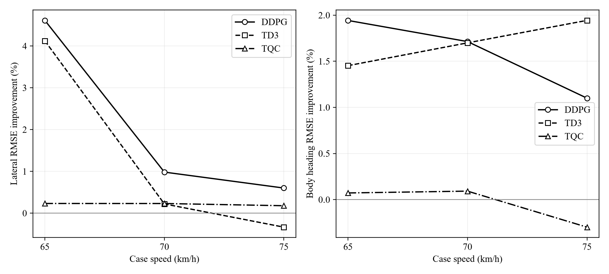
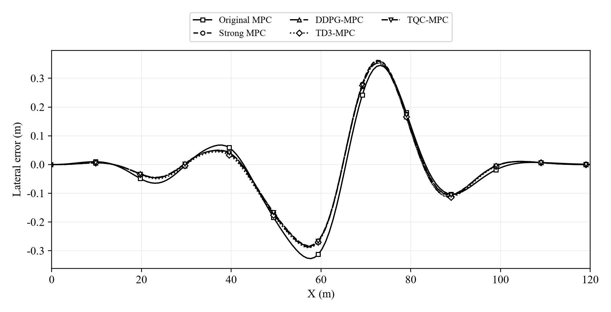
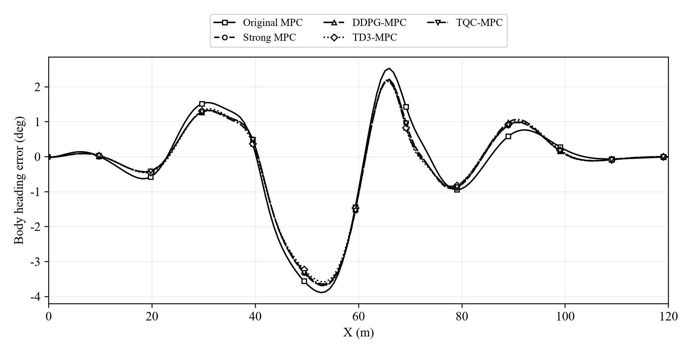
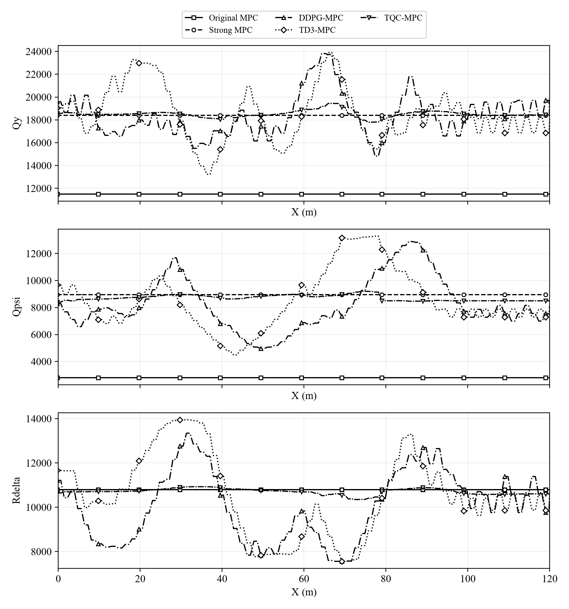

# DRL-MPC多工况实验准备

后续更新：70km/h、mu=0.6已冻结并验收为test，见[低附着验收](CarSim_70kmh_mu06_Preflight.md)；60/.8已验收加入train，见[60训练源与切换检查](CarSim_60kmh_Training_Case.md)。当前train=[70,60]、validation=[65,75]、test=[70/.6]；80及正式选参锁仍待补。下文保留9470d21阶段的搜索结果与待办历史，不代表当前源缺失状态。

基于bf8afd5，2026-11-16执行。主线保持三自由度车辆预测与增量式LTV-MPC，以TQC为重点，公平比较DDPG/TD3/TQC调节MPC参数。本轮未训练、resume、重新选择检查点，未改变车辆、MPC、奖励、动作或网络；未运行15组正式训练。历史成果和MATLAB/转向机器人工程保留。

## 1. 已存在的真实工况与冻结保护

首先核对70/65快照的完整Simfile、Parsfile SHA256及车辆/I/O/轨迹/物理签名，与原报告归档逐项相符，直接复用，未重新建立其源快照。找到当前Browser新生成的75km/h、mu=0.8工况，验证后仅为75建立新源快照。

| 工况 | 实际状态 | 用途与结果 |
|---|---|---|
| 70km/h、mu=0.8 | 原冻结源完整，双基线复现 | train，仍只有这一个训练速度 |
| 65km/h、mu=0.8 | 原冻结源完整，原模型结果哈希可复用 | validation，未转入训练 |
| 75km/h、mu=0.8 | 新原生源存在、兼容，已冻结并验收 | validation，本轮真实双基线与模型回放 |
| 70km/h、mu=0.6 | 未找到兼容原生源，未生成、未仿真 | 预留test，状态待创建，不是失败或通过 |
| 60/80km/h、mu=0.8 | 尚无已验收的兼容训练源 | 最小训练扩展待办，不能当作已完成数据 |

私有源文件路径如下，每个目录均含 `simfile.sim` 和对应 `Run_all.par`：

```text
70:
C:\Users\fengchengmin\Desktop\JQRKZ\DRL-MPC\runs\mainline_weights3_ddpg_20261116_v1\ddpg_v70kmh_100episodes_seed42_20261116_183902\source_case\
65:
C:\Users\fengchengmin\Desktop\JQRKZ\DRL-MPC\runs\validation_65_mu08_20261116_195607\source_65\
75:
C:\Users\fengchengmin\Desktop\JQRKZ\DRL-MPC\runs\multi_scenario_preparation_20261116_202836\source_75\
```

75的原生入口为 `D:\Program Files (x86)\CarSim2024_Date\simfile.sim`，INPUT指向 `D:\Program Files (x86)\CarSim2024_Date\Results\Run_6cb07365-85a3-4a3b-95f9-c5c844687601\Run_all.par`，Run Control为Baseline、Procedure为steer001。原生非注释/非来源标签内容与冻结70相比，唯一差异为 `SPEED_TARGET_CONSTANT 70→75`；MU_ROAD_CONSTANT仍0.8。未通过改名或手改物理参数生成工况。Browser入口是可变文件，后续回放必须使用上述独立快照。

新增 [real_scenario_sets.local.json](../configs/real_scenario_sets.local.json)：train=[70]，validation=[65,75]，test=[]，全部为已验证的真实绝对路径。低附着未建立，不能填写不存在路径或将设计参数冒充源文件。

## 2. 契约、内容哈希与原生接口检查

搜索当前CarSim数据目录、项目和历史C++工作区，列出10078份Simfile，读取7157份静态来源，按完整Parsfile内容去重329份，7份旧引用不可读。找到的目标75/.8兼容源为当前原生入口；未找到兼容70/.6。另对历史目录中100份60/80源重新读取并比较，未有同时满足当前全部契约的候选；不能把旧3入15出文件补几行后入组。

| 共同契约 | 三份已接收源的SHA256 |
|---|---|
| 车辆/轮胎数据块 | `094c90788cf2e417ca8746934c44442e11ce683f817607dbd4b4c444e357fb0c` |
| I/O数据块 | `c37e373b01faa9694ec13ec8c69df9360f5e2a73c9d899e4ef9698019fbb6490` |
| LTARG数值内容 | `b1b923ea798c20a2d5d8ca501abd8efba44c9921fdb7dcc0de8f88bb7216389c` |

| 速度 | 完整Parsfile SHA256 | 物理工况签名 |
|---|---|---|
| 70 | `bb878204652e1351e0fa30e7c6c66654ff61539475e4d06846acbacfc198be7e` | `4b2833a3a0ee9d26069398a2de361ed49c293399e1ff9a67543336fc70687aa7` |
| 65 | `4f8836368263906abe771c65100d69ef80425ed3d8df32189ea9665e293aa0bc` | `34db60360e2714ac115dc734d7e701a8a2b986f9b42fd7f58edbb995d3b083dd` |
| 75 | `082160018decf32e218787694059d37a9378aa02c6cd9aac99f4c52f14e73ef2` | `9f33c9f2d89737f3ae7913d8603761cc8be92450632d313b60c963b9f685cd1a` |

75私有Simfile SHA256为 `5fb47e58da8a482695c7af698b77ef2f0c677bb3433d559e056eb726c2628929`。完整三份Simfile哈希、原生来源哈希、路径和复用证据均在[状态归档](archive/multi_scenario_20261116_status.json)及本轮 `snapshot_verification.json/verified75.json`，不混同原生入口与重定向INPUT的私有快照哈希。

原生与9份75评价Solver echo核对：两路 `IMP_STEER_L1,IMP_STEER_R1`，REPLACE、deg；20路依次为 `Xcg_TM,Ycg_TM,Vx,Vy,Yaw,AVz,Ax,Ay,Steer_L1,Steer_R1,Beta,Rho_Road,AlphL_L1,AlphL_R1,AlphL_L2,AlphL_R2,Fy_L1,Fy_R1,Fy_L2,Fy_R2`。echo名称规范化为大写后逐项相等；速度75、mu=0.8。桥接仍读取SI状态，不把km/h、deg、g显示单位直接作为反馈。LTARG覆盖0–120m且内容相同，采样0.04s、决策0.08s。

安装目录有官方Browser COM手册和示例。只读检查显示Registry32/Registry64均无 `CarSim.Application\CLSID`，GetTypeFromProgID也不可用；没有自动注册、激活、关闭Browser或修改数据库。官方[VehicleSim COM手册](<D:/Program Files (x86)/CarSim2024.1_Prog/Help/Manuals/VehicleSim_COM.pdf>)第3–5页要求管理员手动注册；第33页提供CreateNew/CreateAllParFile原生复制与导出方法。本机尚不满足可直接自动创建的条件。已有Solver DLL和CLI能运行已导出工况，不据此声称Browser数据集自动创建已经可用。

## 3. 双MPC真实安全预检与物理量

使用现有scenario_preflight，对70/65/75各运行原始固定MPC和强MPC，没有改权重或门槛。全部完赛、QP=0，满足峰值|Ay|≤0.85g、|Beta|≤5°。整体ready=false仅因test为空；下面六组基线均真实通过。

| 速度/基线 | 横向RMSE m | 航向RMSE ° | 横向峰值 m | 航向峰值 ° | 峰值Ay m/s² | 峰值Beta ° | 实际终点X m |
|---|---:|---:|---:|---:|---:|---:|---:|
| 70原始 | .087240 | 1.014074 | .228454 | 3.170066 | 7.070283 | 2.074793 | 120.000475 |
| 70强 | .078953 | .919092 | .214754 | 2.946699 | 7.086899 | 2.079141 | 120.001978 |
| 65原始 | .055693 | .727977 | .179320 | 2.556443 | 6.785035 | 1.369805 | 120.002358 |
| 65强 | .045448 | .612186 | .138840 | 2.234185 | 6.778813 | 1.321006 | 120.002299 |
| 75原始 | .137672 | 1.405657 | .345034 | 3.887678 | 7.194089 | 2.779617 | 120.006345 |
| 75强 | .131495 | 1.296435 | .362238 | 3.670070 | 7.256530 | 2.804101 | 120.008234 |

完整[预检CSV](archive/multi_scenario_20261116_preflight.csv)保留所有指标。强MPC在75的横向峰值高于原始MPC，即使其RMSE更低；该结果未被隐藏，也没有重调强基线来改变比较。

实际前后轴侧向力、车体Ay及力平衡另做[物理量审计](archive/multi_scenario_20261116_force.csv)。质量由每次CarSim echo得到1513kg。强MPC的 `peak|Ay|/(mu*g)` 在65/70/75分别约0.864/0.903/0.925；投影车体侧向合力峰值分别约10148/10577/10798N，相应力平衡RMSE约0.0235/0.0332/0.0417m/s²。

这些是实际mu=.8下的整体需求指标，**不是逐轮联合滑移利用率或硬摩擦圆证明**。现有20输出缺少每轮Fz/Fx，不能据 `Ay/(mu*g)` 单独断言轮胎饱和或低附着必定不可行。mu=.6必须在真实工况生成后检查其实际Ay、Beta、Fy、QP和终点；即使通过0.85g门槛，也需结合原生轮胎物理和力平衡审查。当前没有低附着仿真数据。

预检工具已补充失败保留：求解器异常会写入error、未认证完成状态和原始输出位置，QP未知记null而非0；其他工况继续留下记录。真实部分完赛返回的误差、QP和终点仍保留，不将失败删掉或伪装成通过。

## 4. 冻结模型的65/75开发验证

严格沿用[原模型锁](archive/next_stage_20261116_locks.json)：DDPG 2370步、TD3 6320步、TQC 4740步的best_legal_model，完整模型与原checkpoint SHA256一致，配置继承链、动作名/映射、20维观测均一致。仍为Np36、三维 `[Qy,Qpsi,Rdelta]`、原联合奖励和连续映射1.08限速。没有使用final模型或根据65/75结果换检查点。

65复用bf8afd5真实回放：核对模型、配置、工况、原始CSV及控制器/桥接二进制哈希后才引用，未重新选择模型。75通过双MPC预检后，使用evaluate_dual的validation入口真实回放。新75只放入本轮replay75_sets.json供该次评价，正式已接收集合仍含65和75；没有读取test策略性能。

| 速度 | 控制器 | 横向RMSE m | 航向RMSE ° | 相对同速强MPC横向/航向改善 | 双RMSE改善 |
|---|---|---:|---:|---|---|
| 65 | 原始MPC | .055693 | .727977 | — | — |
| 65 | 强MPC | .045448 | .612186 | 0 / 0 | — |
| 65 | DDPG | .043352 | .600292 | 4.6126% / 1.9428% | 是 |
| 65 | TD3 | .043574 | .603292 | 4.1234% / 1.4528% | 是 |
| 65 | TQC | .045343 | .611744 | .2319% / .0722% | 是 |
| 75 | 原始MPC | .137672 | 1.405657 | — | — |
| 75 | 强MPC | .131495 | 1.296435 | 0 / 0 | — |
| 75 | DDPG | .130705 | 1.282171 | .6010% / 1.1002% | 是 |
| 75 | TD3 | .131935 | 1.271237 | **−.3347%** / 1.9436% | 否 |
| 75 | TQC | .131261 | 1.300307 | .1780% / **−.2987%** | 否 |

75所有控制器均完赛且QP零失败。三策略的横向峰值分别0.352944/0.354759/0.359438m，航向峰值3.642308/3.578086/3.687890°；峰值Ay7.247146/7.236548/7.257604m/s²，Beta2.791427/2.753504/2.824478°，转向速率RMS10.507929/10.347848/10.238112°/s。对应强MPC为0.362238m、3.670070°、7.256530m/s²、2.804101°、10.281892°/s。不存在车辆稳定性或QP故障，但存在误差与平顺性权衡。

75各策略MPC计算均值约0.229/0.232/0.231ms，CPU推理均值约0.579/0.444/0.724ms；全部p95和航迹角RMSE在[完整开发验证CSV](archive/multi_scenario_20261116_development.csv)。计时不含CarSim积分、IPC等全链路延迟，不用于正式时延排名。

复用joint_validation的纯聚合函数，评价固定注册模型在65/75上的表现，没有调用选模保存逻辑：

| 模型 | 平均相对改善：横向/航向 | 最差工况改善：横向/航向 | 双改善工况比例 | 两工况全严格双改善 |
|---|---|---|---:|---|
| DDPG | 2.6068% / 1.5215% | .6010% / 1.1002% | 100% | 是 |
| TD3 | 1.8944% / 1.6982% | −.3347% / 1.4528% | 50% | 否 |
| TQC | .2049% / −.1132% | .1780% / −.2987% | 50% | 否 |

这些均值是**跨两个开发工况**，不是多随机种子均值。单seed42、同一路径不足以建立最终算法排名；TQC/TD3的局部退化也不足以归因于算法结构。当前所有源使用相同LTARG，只验证速度变化，尚无低附着或道路轨迹泛化证据。









图使用真实样本，黑白线型/空心标记区分，英文数字Times New Roman、中文字体配置SimHei；70点注明为训练诊断，不能与开发点混作最终测试。五控制器实际轨迹、绝对RMSE及全部PDF另见本轮figures75目录。

## 5. 多工况训练机制审计与最小修复

| 项目 | 审计结论与处理 |
|---|---|
| train集合切换 | train_env真实使用sets.train；修复无显式Simfile时仍从可变Browser读取训练来源/元数据/首轮parity的问题，现取清单中训练源；显式清单外源拒绝 |
| 回合边界 | step内不换工况；训练SB3在terminated/truncated后reset，包括失败回合；Gym手动reset接口保留 |
| Solver隔离 | reset先关闭旧桥接，再创建新子进程；C++每回合重新读取私有Parsfile、LTARG、速度、道路附着、车辆/轮胎和初始状态 |
| 采样公平性 | 保持原uniform_episode_v1，有放回等概率；环境使用独立Gym RNG，同seed有相同回合索引前缀，不消耗算法探索的全局随机数 |
| 重复源 | 拒绝同split内物理重复条目，防止重命名/重复路径人为增加某工况采样权重；跨split重复仍拒绝 |
| 决策预算 | --total-decisions按真实RL交互计数，当前train_freq=1；新增每工况实际返回的决策计数并校验总和等于学习器新增num_timesteps；空reset不算决策 |
| 验证隔离 | 原非joint分支未使用scenario-set验证列表；现清单训练必须显式--joint-selection且验证非空，禁止同时混用--validation-simfile；旧无清单接口保持 |
| 梯度与选模 | JointValidator使用独立环境、确定性predict，不进训练经验池；只遍历validation，全部合法/严格双改善及Pareto规则不变；test仅冻结元数据，未用于更新或选择 |
| 正式闸门 | formal_compare增加至少两种已验证训练速度的要求，并记录统一采样规则；仍需完整分集、双基线证明和超参数选择锁 |

等概率回合采样不保证有限预算内每种工况同样回合数，也不保证不同车速相同决策数。不同算法若失败率不同，会消耗不同回合数；相同seed保证索引前缀，不能保证每算法最终前缀长度一致。因此记录实际工况暴露步数，不能宣称已经实现严格等工况步数配额。

本轮在同一真实CarSim环境实施**无学习器接口测试**：seed42顺序70→65→65→70，四个不同子进程，均在回合结束后关闭，首次实测速度与所选源一致；每次均返回20维有限观测并复现对应强MPC。每回合决策79/85/85/79，总328；按源为70的158决策与65的170决策。没有策略训练、经验池或梯度，65未被转入训练集。[采样证据](archive/multi_scenario_20261116_sampling.json)保存PID、源签名和指标。

因此**真实切换机制及训练路由已验证，真实多工况DRL训练尚未执行**。当前train仍单一70，不能因为有scenario_pool或完成接口探针就声称多工况训练成功。

## 6. 低附着原生生成操作与最小训练扩展

低附着GUI操作单（不改旧数据集）：

1. 先保留本报告三份私有源，尤其新75；之后Browser覆盖其默认simfile也不影响复现。
2. 在当前CarSim 2024.1数据库复制Run Control **Baseline**，新建唯一名称，例如Heldout_70_mu06；使用Duplicate/New Dataset，不覆盖旧Baseline。
3. 复制其Procedure **steer001**为独立副本，返回新Run Control确认链接指向副本。保持速度控制方式，将副本恒定目标速度设70km/h；核对生成的SPEED_TARGET_CONSTANT=70，其他速度组合项不变。
4. 在副本Procedure的道路附着链接进入 **Road: Friction Map, S-L Grid / Constant / Constant: 0.8**（原RdMu_97c75a76-f8f4-4432-ac41-ccc20b5eb28f）。复制为Constant:0.6_heldout，再把副本的常附着设0.6，保持MU_ROAD_L_CONSTANT=0和组合方式；返回Procedure确认使用新附着副本。不能修改仍被旧70/65/75引用的0.8共享数据集。
5. 保持车辆/轮胎Assembly、转向模式、道路几何Straight East和 **DLC SYX**目标路径。保持原2路REPLACE/deg导入和上述20路导出顺序，不能改成3/15，不能用Rho_Road替代LTARG。
6. 保持原Models连接，用Browser原生Generate Files for this Run（或当前Run Math Model生成流程）导出完整Simfile/Run_all.par，保留新Run UUID和结果目录。不要用文本替换旧Par/Simfile构造新例。Browser单独生成/运行并不等于C++ MPC闭环验收。
7. 核对原生速度、附着、车辆/I/O/轨迹哈希及不同物理签名，再做私有冻结。先放入明确标记为候选的清单，只运行原始/强MPC安全预检，不做策略调参。若未完赛、QP失败或不安全，保留全部实际轨迹/错误，标记pending/unsafe并留在待处理记录，不能加入正式已验收集合。
8. 结合实际Fy、Ay、Beta、原生轮胎参数和力平衡判断低附着可行性；不调强MPC、不放宽门槛、不虚构完成。不通过时不要直接删除该困难工况。最终接收后才将test真实路径加入real_scenario_sets，测试策略仅在最后的预锁定最终报告阶段回放。

若未来希望COM自动化，应由用户按已安装官方手册注册正确版本并完成只读连接/导出验证，再用于新独立数据集；本轮未执行管理员注册，也未执行SDK示例中的删除/手工改文件操作。

最小训练扩展为真实 **60/.8、70/.8、80/.8**，其中70直接复用，60和80需复制独立Procedure改变恒速后原生导出、同契约核对及双基线验收；当前不存在可直接填入集合的兼容已验收60/80。65与75继续开发验证，不偷偷移入train。所有道路仍相同，只能研究速度/附着鲁棒性；轨迹泛化需另设真实曲率/路径集合。

正式方案保持三维权重、20维观测、联合奖励、共同车辆/MPC、各算法相同真实交互预算和验证集，种子42–46。正式预算与公平超参数搜索应先冻结；本轮formal_plan中的7900仅为技术预检预算，没有执行其15条命令。旧best模型锁用于回放来源，不能代替尚缺的多工况超参数选择锁。TQC为重点研究对象，标准不因预期排名改变。

## 7. 产物、验收及下一阶段命令

本轮完整根目录：`runs/multi_scenario_preparation_20261116_202836/`。

- snapshot_verification、verified75、discovery、training_60_80_candidates、physical_diff：快照/新源及不合格候选证据；api_audit记录官方手册读取与双架构注册状态。
- preflight：6组真实双基线；force_feasibility.csv记录实际轮胎力指标。
- evaluation75：原始9行配套基线/模型记录，完整CarSim日志、轨迹、动作请求/目标/执行、C++报告和时延。
- development_metrics.csv：65复用与75新数据10行统一表；reuse65_verification/post_verification记录原锁、工况和配置保护。
- frozen_validation_aggregate.json：固定模型的全工况严格结果、平均/最差及达标比例，未重新选模。
- switch_probe、switch_probe_result.json、training_source_audit.json：真实切换与训练锚点检查；parity75：147控制步全程零动作一致性通过。
- formal_plan：ready=false，缺test、多个训练速度、完整分集预检证明和多工况超参数锁；executed=false。没有把缺失test误报为现有基线失败。
- figures75和relative_improvement_speed：论文风格PNG/PDF；[小型归档](archive/multi_scenario_20261116_status.json)及相关CSV/JSON与关键PNG随代码提交，大模型/runs留本地不覆盖。

验收：Release通过，CTest 1/1，pytest **69/69**，75真实zero-action parity 147步通过，4个真实回合切换通过，75实际三算法与六组多速度固定基线均完成。未执行：mu=.6求解、60/80新训练工况生成、多工况DRL训练、正式多种子训练、TQC截断消融。当前仍不具备正式三算法训练条件。

以下在项目根PowerShell运行，每次换用不存在的新输出目录；不包含启动训练的命令：

```powershell
$env:OMP_NUM_THREADS='1'
$env:MKL_NUM_THREADS='1'
$env:PYTHONDONTWRITEBYTECODE='1'
cmake --build out/python-rl-build --config Release --parallel 4
ctest --test-dir out/python-rl-build -C Release --output-on-failure
uv run --no-project --with-requirements python/requirements.txt --with pytest python -m pytest python/tests -q -p no:cacheprovider

# 实际已验收源集合，当前test为空；整体ready=false不代表6组基线失败。
uv run --no-project --with-requirements python/requirements.txt python python/scenario_preflight.py --scenario-set configs/real_scenario_sets.local.json --out runs/multi_preflight_NEW
$case75 = (Get-Content configs/real_scenario_sets.local.json -Raw | ConvertFrom-Json).validation[1]
uv run --no-project --with-requirements python/requirements.txt python python/parity.py --config configs/strong_weights3.ini --simfile $case75 --blocks 200 --out runs/parity75_NEW

# 只评价原锁模型；若重复65，应先核对旧源/模型哈希，不覆盖旧结果。
uv run --no-project --with-requirements python/requirements.txt python python/evaluate_dual.py --lock docs/archive/next_stage_20261116_locks.json --scenario-set configs/real_scenario_sets.local.json --split validation --out runs/development_replay_NEW
uv run --no-project --with-requirements python/requirements.txt python python/report.py runs/development_replay_NEW --locked-validation --case 1 --reference-models docs/archive/next_stage_20261116_metrics.csv --reference-baselines docs/archive/next_stage_20261116_objectives.csv --out runs/development_replay_NEW/figures75

# 仅生成15组命令和阻塞清单，不能附--execute。
uv run --no-project --with-requirements python/requirements.txt python python/formal_compare.py --profile weights3 --scenario-set configs/real_scenario_sets.local.json --train-config configs/rl_training_pilot.ini --total-decisions 7900 --out runs/multi_formal_plan_NEW
```

下一步最小顺序：Browser生成并核验70/.6 → 低附着双基线与物理可行性审查 → 原生60/80训练源及基线 → 冻结多工况预算、验证选参规则和模型锁 → 先小规模功能训练再讨论正式15组。现阶段不应仅因75的一项误差退化而直接扩大训练、修改网络或更换研究主线。
