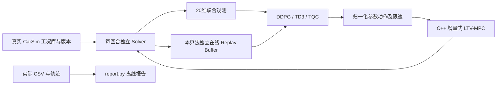

# 项目总览

研究重点为 TQC 调整增量式 LTV-MPC 参数，与 TD3、DDPG 公平比较，不预设排名。CarSim 是真实被控对象；C++ 三自由度预测模型和 MPC 求转角，Python SB3 仅输出参数请求。

| 目录 | 职责 |
|---|---|
| src/、tests/ | 控制器、车辆预测、Solver 接口、C++ 回归 |
| python/ | 训练、工况管理、验证、回放、报告和测试 |
| configs/ | 不可改义的基线与兼容配置链，见 README |
| datasets/carsim/ | 原生工况、注册、不可变版本、统计 |
| runs/ | 保留的模型、完整日志、私有来源与实验数据 |
| reports/ | 可从实际日志重新生成的统一 HTML/PNG/PDF |
| docs/archive/ | 有独特证据的历史报告和锁，非日常入口 |
| matlab/ | 独立研究工程，不改动 |

日常只需六份说明：[MPC](MPC_MODEL_AND_BASELINES.md)、[DRL与奖励](DRL_DESIGN_AND_REWARD.md)、[数据集](DATASET_GUIDE.md)、[实验命令](EXPERIMENT_GUIDE.md)、[有效结果](RESEARCH_RESULTS.md)和本页。删除/迁移的旧入口见 [HISTORY_INDEX](HISTORY_INDEX.md)，依赖与清理明细见 [审计](PROJECT_REFACTOR_AUDIT.md)。
