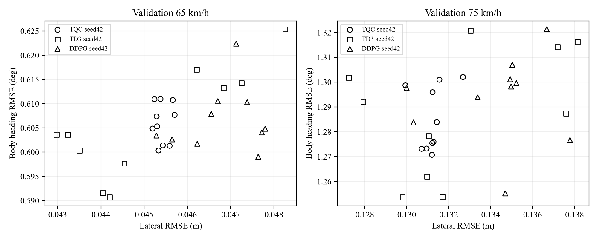

# 版本化工况库上的三算法在线技术预实验

本页实验结果冻结于2026-11-16、来源e83f7fb；2026-11-18结构整理验收见 PROJECT_REFACTOR_AUDIT.md。

本轮使用真实 CarSim 在线闭环，未修改三自由度预测模型、增量式 LTV-MPC、车辆/轮胎物理参数、参考轨迹、网络、奖励或动作空间。TQC 为研究重点，与 TD3、DDPG使用统一数据集及验证规则，不预设排名。本报告是 **seed42、固定参考轨迹、速度变化的开发验证**，不是五种子正式比较，也未运行预留低附着 test 的 DRL 策略。

## 实际运行与数据冻结

- 基准提交：`00a68f8`；本轮从干净工作区开始。
- 数据版本：`datasets/carsim/manifests/dataset_v1.json`。
- 数据哈希：`920bec95afaee29ab441a8ce60cc1f5b11c04bcdb04325f7bf8287debaa5dc9f`。
- train=70/60/80 km/h、μ=0.8，保留有序池和历史 RNG 语义；validation=65/75、μ=0.8；test=70、μ=0.6。旧 `configs/real_scenario_sets.local.json` 未更改。
- 控制配置 `configs/strong_weights3.ini`，训练配置 `configs/rl_training_pilot.ini`。Np=36、Nc=13，动作 Qy/Qpsi/Rdelta，20 维联合观测、联合奖励、连续对数映射、变化率 1.08，MPC 0.04 s、决策 0.08 s。
- 各算法均 seed42、7900 个真实 decision、550 个预热 decision、每 790 个 decision 验证两个开发工况；每步一次梯度更新，共 7350 次。各自随机初始化网络和独立空经验池，没有 resume 或共享经验。
- 真实运行先 TQC，技术完成后依次运行 TD3、DDPG。每个训练输出目录独立，全部周期模型、final、best_legal、验证记录和实际轨迹保留。

实际目录：

```text
runs/dataset_system_20261116_222225/
  acceptance.json
  cases/                        # 从版本 manifest 冻结的六个工况
  switch_probe/                 # 六回合真实零动作工况切换
  parity_0/ parity_1/ parity_2/  # 三训练源全程零动作一致性
  tqc/tqc_v70kmh_100episodes_seed42_20261116_222250/
  td3/td3_v70kmh_100episodes_seed42_20261116_223044/
  ddpg/ddpg_v70kmh_100episodes_seed42_20261116_223402/
  training_execution_audit.json
```

子目录名称中的 `v70kmh_100episodes` 是旧命名接口保留的首源和请求值；真实训练采用三个工况及**精确 7900 decision**，不以此名称判定工况或预算。每算法实际 100 个有样本回合，其中 99 个完整结束，最后一个因预算结束保留 50 个 decision 的部分回合。这不是求解器失败。

## 真正的训练源暴露量

下表对三个算法均相同，本轮实际核对了 episode 日志、样本计数与 Replay Buffer。相同 seed 的有序随机采样在这三次实际运行中产生相同暴露量；一般情形不承诺有限次数内工况等频，也不将 uniform_episode 称为等 decision 采样。

| km/h | 有真实样本回合 | 完整回合 | 实际 decision | 样本占比 |
|---:|---:|---:|---:|---:|
| 70 | 27 | 26 | 2104 | 26.633% |
| 60 | 33 | 33 | 3036 | 38.430% |
| 80 | 40 | 40 | 2760 | 34.937% |
| 每算法 | 100 | 99 | 7900 | 100% |

三算法共采集 23700 个真实 decision，不包括验证、基线、parity 和 reset。各自最终 Replay Buffer=7900，初始=0；validation_used_for_updates=false。六回合切换探针为 70→80→60→60→60→80，共 493 decision、六个不同 Solver 进程，均到达参考终点、QP=0；仅用于接口验收，没有训练。

## 开发验证结果

选择规则保持：完赛、QP=0、Ay≤0.85g、|Beta|≤5°；在每个 validation 工况横向与车身航向 RMSE 均优于该工况强 MPC，才判定全部工况达标。合法检查点按各工况 min(Iy,Iheading) 的最差值选取。final 只诊断，不能代替周期选模。

强 MPC 对照：65 km/h 为 **0.045448 m / 0.612186°**，75 km/h 为 **0.131495 m / 1.296435°**。以下选模只使用 validation，没有读取 test 策略结果。

| 算法 | 最佳合法步数 | 65 km/h：横向 m / 航向 ° | 75 km/h：横向 m / 航向 ° | 全部工况双改善 |
|---|---:|---|---|---|
| TQC | 7110 | 0.045331 / 0.600353 | 0.130949 / 1.273253 | 是 |
| TD3 | 7900 | 0.044201 / 0.590665 | 0.129800 / 1.253589 | 是 |
| DDPG | 2370 | 0.045646 / 0.602643 | 0.129996 / 1.297691 | 否 |

相对对应速度强 MPC 的 Iy/Iheading：

| 算法 | 65 km/h | 75 km/h | 平均 Iy / Iheading | 最差单项改善 |
|---|---|---|---|---:|
| TQC | +0.257% / +1.933% | +0.415% / +1.788% | +0.336% / +1.860% | +0.257% |
| TD3 | +2.743% / +3.515% | +1.289% / +3.305% | +2.016% / +3.410% | +1.289% |
| DDPG | −0.435% / +1.559% | +1.140% / −0.097% | +0.352% / +0.731% | −0.435% |

DDPG 的平均两项改善均为正，但两个工况分别有一项退化，因此双改善工况比例为 0/2，不能标记达标。其 best_legal、全部周期模型和 Pareto 候选仍保留，未生成 best_joint。TQC、TD3 均为 2/2，并保存 best_joint。三算法全部 66 次验证回放（每算法 10×2 周期加 2 次 final）均完赛、QP=0 且通过既定稳定性门槛。

| 算法最佳合法模型 | validation 最大 Ay (m/s²) | 最大绝对 Beta (°) |
|---|---:|---:|
| TQC | 7.246656 | 2.807932 |
| TD3 | 7.268258 | 2.838237 |
| DDPG | 7.267699 | 2.867478 |

原始逐工况峰值、航迹角 RMSE、相对原始 MPC 改善、完整距离及奖励分项等保留于 `pilot_validation_metrics.csv` 和各运行 `joint_validation.csv`，不以平均值掩盖困难工况。

## 最终模型与后期变化

| 算法 final（仅诊断） | 65 km/h：m / ° | 75 km/h：m / ° | 双改善工况比例 |
|---|---|---|---|
| TQC | 0.045592 / 0.601338 | 0.130654 / 1.273970 | 1/2 |
| TD3 | 0.044241 / 0.590506 | 0.130346 / 1.252798 | 2/2 |
| DDPG | 0.048746 / 0.608704 | 0.133621 / 1.294042 | 0/2 |

TQC final 在 65 km/h 横向比强 MPC 差 0.317%，说明保存验证最佳模型仍有必要；不能把 final 的 75 km/h 横向更好替代全部工况规则。DDPG 后期横向退化明显，最差单项改善从最佳合法 −0.435% 变为 final −7.258%。TD3 final 仍双改善，但最差改善从 1.289% 降为 0.873%。

SB3 周期 callback 位于相应 rollout 的梯度更新之前，故第 7900 步周期模型与 final 可相差最后一次梯度更新，其 SHA 和回放指标分别记录。这是两份不同模型，不拼接指标。训练回报由不同速度回合混合，不能直接代替验证双 RMSE，也不能由单个 seed 得出训练稳定性或最终算法排名。

扫描全部实际训练轨迹：TQC/TD3/DDPG 峰值 Ay 分别为 7.332744/7.317761/7.321664 m/s²，峰值 |Beta| 分别为 4.676720/4.794495/4.863811°，没有超出本轮安全门槛的已采集回合。全部训练 QP=0；80 km/h 已接近侧偏门槛，后续仍需逐回合监测，不能据本轮推广到更高速度或低附着。

## 结果文件与图

`datasets/carsim/reports/dataset_v1_seed42_pilot/` 包含：

- dataset_summary.csv、dataset_statistics.json、dataset_manifest.json：版本化工况及三算法合计样本统计；只汇总同 hash 的实际日志。
- pilot_validation_metrics.csv：最佳合法及 final，逐算法、逐工况，含两套基线改善和安全指标。
- pilot_model_locks.json：新运行的最佳合法模型、来源检查点及 SHA。旧 `docs/archive/next_stage_20261116_locks.json` 不变。
- 各算法完整 joint_validation/checkpoint_aggregate/train_monitor CSV。
- training_execution_audit.json：版本、来源、配置、模型/日志 SHA、实际软件版本及计数核对。
- training_safety_audit.json：扫描全部实际训练轨迹的 Ay/Beta 结果。
- dataset_table、decision_exposure、training_curves、checkpoint_validation、checkpoint_pareto、validation_tracking、executed_weights 的 PNG/PDF。英文数字 Times New Roman、中文 SimHei，黑白线型/空心标记可区分。




## 直接复现命令

需本机 CarSim 2024.1 许可/DLL、完整本地工况数据与 Python 依赖；先用 dataset_manager validate 核验。输出使用新的唯一目录。以下不会启动五种子正式训练：

```powershell
$env:OMP_NUM_THREADS='1'
$env:MKL_NUM_THREADS='1'
$env:PYTHONDONTWRITEBYTECODE='1'
python python/dataset_manager.py validate
python python/train.py --algorithm tqc --config configs/strong_weights3.ini --train-config configs/rl_training_pilot.ini --scenario-set datasets/carsim/manifests/dataset_v1.json --episodes 100 --total-decisions 7900 --seed 42 --eval-frequency 790 --joint-selection --training-only --keep-training-traces --parity-blocks 200 --out runs/dataset_v1_tqc_NEW
# TQC 技术成功后，将 algorithm 和 out 分别改为 td3、ddpg；不得 resume。
python python/dataset_manager.py summary --manifest datasets/carsim/manifests/dataset_v1.json --run 'runs/实际TQC输出/实际训练子目录' --run 'runs/实际TD3输出/实际训练子目录' --run 'runs/实际DDPG输出/实际训练子目录' --out datasets/carsim/reports/新统计目录
cmake --build out/python-rl-build --config Release
ctest --test-dir out/python-rl-build -C Release --output-on-failure
uv run --no-project --with-requirements python/requirements.txt --with pytest python -m pytest python/tests -q -p no:cacheprovider
```

训练开关、源采样和验证均复用现有 train.py/CarSimMPCEnv/JointValidator，没有新增训练框架。工况注册、扩展、版本与备份方式见 [DATASET_GUIDE.md](DATASET_GUIDE.md)。

## 验收与下一步

Release 构建通过；CTest 1/1；pytest 80 项通过（新增库、版本、迁移、源数量和真实计数语义测试）。三个训练源全程 zero-action parity 分别检查 157/183/137 个控制步；实际切换验收和三算法共 23700 decision 已完成。六源原始文件 SHA 和既有 12 组固定基线证明完整，历史文件未覆盖。未运行预留 test 的策略评价、未运行五种子正式训练，未更改 MATLAB 工程。

下一步先核查本轮周期验证和后期变化，预先冻结公平的超参数搜索及选择规则，再用相同不可变数据集准备五种子实验。当前是技术预实验完成，并非正式比较条件自动满足；formal_compare 仍要求独立的验证选参锁。不得为了使 TQC 领先而修改评价条件。未来增加真实曲率/变速/附着分段源，必须先注册、完成适用性与真实求解器验收、发布新版本，不能在现有训练版本运行过程中改变集合。
## 弱起点三算法对比（2026-11-21）

本次使用独立的 `weak_demo_v1`，仅在 70 km/h、μ=0.8、120 m 双移线上训练，以同参考轨迹的 65/75 km/h 工况做开发验证。派生版本哈希为 `c1724ca1c99ff37edc8b98133c4cf859431ea29b138d1af8e57d7698aa2229a3`。弱 MPC 为 Np=36、Nc=13、Qy=3000、Qpsi=700、Rdelta=172800。三个策略均从此中性起点训练。详见 [参数与真实候选核验](MPC_MODEL_AND_BASELINES.md)。

60 个稳定候选中有 24 个处于横向目标区间。按修订目标复核既有扫描，候选 3 仍为横向达标组中航向差距最接近目标的稳定方案。内部参考在 70 km/h 的横向改善为 36.48%，航向改善为 3.41%。航向距离 10% 下限还有 6.59 个百分点。保存了两次目标口径以及相同候选的复核证据。

| 控制器 | 70 km/h 同工况，m / ° | 65 km/h 开发验证，m / ° | 75 km/h 开发验证，m / ° |
|---|---:|---:|---:|
| 弱 MPC | 0.124305 / 0.951541 | 0.082350 / 0.700705 | 0.178156 / 1.279659 |
| DDPG-MPC best | 0.075187 / 0.909303 | 0.043075 / 0.601749 | 0.128420 / 1.265594 |
| TD3-MPC best | 0.085991 / 0.871901 | 0.048696 / 0.569813 | 0.141297 / 1.266062 |
| TQC-MPC best | 0.101781 / 0.867690 | 0.066257 / 0.615745 | 0.151148 / 1.199479 |

| best 相对同速度弱 MPC | 70 横向 / 航向 | 65 横向 / 航向 | 75 横向 / 航向 |
|---|---:|---:|---:|
| DDPG-MPC | +39.51% / +4.44% | +47.69% / +14.12% | +27.92% / +1.10% |
| TD3-MPC | +30.82% / +8.37% | +40.87% / +18.68% | +20.69% / +1.06% |
| TQC-MPC | +18.12% / +8.81% | +19.54% / +12.13% | +15.16% / +6.27% |

| 算法 | best_legal | best_joint | 前 10 → 末 10 回合平均回报 | final 70 km/h，m / ° | final 65 km/h，m / ° | final 75 km/h，m / ° |
|---|---:|---|---:|---:|---:|---:|
| DDPG | 7900 步 | 7900 步 | −55.383 → −31.558 | 0.075147 / 0.907928 | 0.042981 / 0.605050 | 0.128414 / 1.265508 |
| TD3 | 7900 步 | 未通过原有门槛 | −54.953 → −36.005 | 0.085858 / 0.875991 | 0.047376 / 0.573929 | 0.141357 / 1.266719 |
| TQC | 7900 步 | 未通过原有门槛 | −55.562 → −46.987 | 0.101732 / 0.867273 | 0.066263 / 0.615881 | 0.151155 / 1.199563 |

每算法 100 个完整回合、7900 个决策、7350 次梯度更新、初始 replay 为 0，训练 QP 失败为 0。每次保存的周期检查点和独立 final 均保留，最后一个周期检查点与最终更新后的模型可有不同权重。21 组主表及补充模型回放全部完赛、QP=0，最大峰值 Ay=7.266223 m/s²、最大峰值 |Beta|=2.881261°。两项 RMSE 均以原始轨迹独立复算，误差小于 1e-12，65/75 回放与原验证记录复核一致。

本次没有发现一致的训练后期退化。各模型的 final 与 best 有小幅双向波动，例如 TD3 在 65 km/h 的横向 RMSE 从 0.048696 m 降至 0.047376 m，航向 RMSE 从 0.569813° 升至 0.573929°。TQC 在 65/75 的 final 与 best 接近。当前结果支持同一路径的两组开发速度对比，过拟合与更广泛的泛化仍需要额外数据判断。

可复核证据位于本机 `runs/weak_mpc_demo_20261121/` 与 `reports/weak_mpc_vs_3drl_20261121_214109/index.html`。主报告包含12条主比较指标与9条 final 独立指标、21张300 dpi PNG、21份矢量PDF、21份相对路径的 C++ 控制报告。内部强基线数据位于 `audit/`。预留低附着 test 的策略评价未执行。离线重建见 [实验指南](EXPERIMENT_GUIDE.md)。

## 100 回合训练诊断

冻结的三次 seed42 运行各有 100 个真实完赛回合。按 Monitor 回报统计，DDPG、TD3、TQC 在第 41–70 回合至第 71–100 回合的均值分别为 −36.764 → −31.676、−42.897 → −38.790、−51.281 → −48.137。末 30 回合标准差依次为 0.344、2.483、2.698。DDPG 在此窗口波动较小且改善趋缓。末窗回报的比较限于相同 70 km/h 训练工况。

各算法的 Actor/Critic 日志均为有限值。TQC 首个记录到最后记录的熵系数约为 0.992 → 0.480。三种损失使用各自的目标和网络，按算法内部曲线读数。DDPG 在 6320 个决策首次通过原有强基线联合门槛。TD3/TQC 十个周期候选均未通过，最差工况联合分数在第 7900 个决策分别为 −7.45% 和 −45.79%。按不同误差分别比较时，TQC 在 75 km/h 的航向 RMSE 更低，横向 RMSE 更高。

TQC 最佳模型的 70 km/h 回放显示，Qy/Qpsi/Rdelta 的执行中位数约为 4418/693/175153。Qy 请求随状态变化，归一化请求标准差为 0.270，约 30% 的决策需要 Qy 限速。Qpsi 和 Rdelta 请求约 76% 与 75% 位于 |a|<0.1 范围。三个执行权重在这次确定性回放均未进入各自边界的 2% 对数区间。Qy 的执行位置低于弱起点动作上界，Rdelta 中位数仍接近弱起点 172800。横向、航向损失分项均值约为 0.26、0.19。这个横向与航向指标的取舍尚不足以确定由哪一个训练因素引起。

## 弱起点 300 回合预算实验

冻结弱基线、中性动作映射、训练和开发验证工况。三算法均为 seed42、随机初始化、空经验池。使用 `--episodes 300` 触发 `StopTrainingOnMaxEpisodes`，全程保留训练和周期验证轨迹。选模使用 65/75 km/h，对两个速度的横向和航向 RMSE 共四项指标，取相对强 MPC 的最小改善率作为周期合法候选的分数。final 在训练结束后独立验证。70 km/h 仅用于同工况诊断，预留低附着 test 未参与回放或选模。主比较的分母为同速度弱 MPC。

| 算法 | 完赛回合 | 决策 | 梯度更新迭代 | 最佳合法检查点（决策） | 强 MPC 联合门槛 | best / final 最差相对强 MPC 改善 |
|---|---:|---:|---:|---:|---|---:|
| DDPG | 300 | 23700 | 23149 | 12000 | 通过 | +1.95% / +1.05% |
| TD3 | 300 | 23700 | 23149 | 10000 | 通过 | +1.80% / −3.58% |
| TQC | 300 | 23700 | 23149 | 23000 | 未通过 | −9.67% / −9.08% |

决策数由 Monitor 与 CarSim 完赛记录逐回合复核。三个运行各保留 23 个周期检查点、46 条周期验证轨迹及两条 final 验证轨迹。SB3 的回合停止回调在写入最后一条终止转移前退出，故经验池各有 23699 条转移。梯度更新为 SB3 的训练迭代计数，TD3 的 Actor 仍按 `policy_delay=2` 更新。三个新运行前 100 回合的逐回合回报及决策数与对应旧运行完全一致。旧、新运行分别每 790、1000 个决策验证，best 对照含这项检查点取样差异。

| 工况 | 算法 | 100 best 横向 m / 航向 ° | 300 best 横向 m / 航向 ° | 300 final 横向 m / 航向 ° |
|---|---|---:|---:|---:|
| 70 km/h 同工况 | DDPG | 0.075187 / 0.909303 | 0.075961 / 0.894452 | 0.075192 / 0.908107 |
| 70 km/h 同工况 | TD3 | 0.085991 / 0.871901 | 0.075684 / 0.908784 | 0.081298 / 0.859714 |
| 70 km/h 同工况 | TQC | 0.101781 / 0.867690 | 0.082451 / 0.898957 | 0.082305 / 0.900558 |
| 65 km/h 开发验证 | DDPG | 0.043075 / 0.601749 | 0.043227 / 0.600225 | 0.042419 / 0.605769 |
| 65 km/h 开发验证 | TD3 | 0.048696 / 0.569813 | 0.043476 / 0.601165 | 0.047076 / 0.574522 |
| 65 km/h 开发验证 | TQC | 0.066257 / 0.615745 | 0.049841 / 0.607706 | 0.049576 / 0.607919 |
| 75 km/h 开发验证 | DDPG | 0.128420 / 1.265594 | 0.128244 / 1.265026 | 0.127819 / 1.269180 |
| 75 km/h 开发验证 | TD3 | 0.141297 / 1.266062 | 0.128428 / 1.268717 | 0.133723 / 1.210365 |
| 75 km/h 开发验证 | TQC | 0.151148 / 1.199479 | 0.134121 / 1.258953 | 0.133895 / 1.257017 |

按 65/75 km/h 等权平均，横向由低到高为 DDPG（0.085736 m）、TD3（0.085952 m）、TQC（0.091981 m）。航向由低到高为 DDPG（0.932625°）、TQC（0.933330°）、TD3（0.934941°）。各算法在两个速度的两项 RMSE 均优于弱 MPC。75 km/h 的绝对误差最大，也是三算法相对弱 MPC 航向改善最小的工况，依次为 DDPG +1.14%、TD3 +0.86%、TQC +1.62%。TQC 在 75 km/h 航向第一，65 km/h 两项指标均处在第三。当前比较只有 seed42，结果未支持 TQC ≥ TD3 > DDPG 的假设。

与 100 best 相比，DDPG 的两工况误差变化较小，TD3 的横向改善并达到强基线联合门槛。TQC 在 70、65、75 km/h 的横向 RMSE 分别下降 19.0%、24.8%、11.3%，65 km/h 航向也改善，70/75 km/h 航向上升。TQC 在两个开发速度仍保持相对强 MPC 的航向优势（+0.73%、+2.89%），横向差距仍为 −9.67%、−2.00%，故没有 `best_joint_model`。TQC final 的联合分数继续小幅改善，保留为诊断。强 MPC 相对指标详见 `audit/relative_to_strong.csv`。

| 算法 | 第 241–270 回合均值 | 第 271–300 回合均值 | 最后 30 回合回报标准差 | 最后 30 回合回报线性斜率 |
|---|---:|---:|---:|---:|
| DDPG | −31.559 | −31.598 | 0.279 | −0.0059 |
| TD3 | −32.004 | −32.017 | 0.461 | +0.0158 |
| TQC | −34.079 | −33.645 | 0.668 | −0.0243 |

DDPG 后段回报较平稳，final 的航向比 best 略差，仍达到强基线联合门槛。TD3 的后段回报也趋平，final 航向误差下降、横向误差上升，导致联合门槛失守。TQC 末窗均值高于前窗，末窗内的线性斜率为负，晚期仍有波动。三个算法的 Actor/Critic 日志均为有限值。损失量级随目标函数和更新机制变化，控制结论以真实回放的两项误差和安全指标为依据。

### TQC 探索、动作执行与学习速度

TQC 优化器沿用冻结配置。Actor、Critic、熵优化器学习率分别为 1e-4、3e-4、1e-4。自动目标熵在三维动作下为 −3，训练每次交互后更新一轮，预热 550 决策。三个 Critic 各输出 25 个分位数，合并后舍弃最高 6 个目标，保留 69 个。训练记录中的熵系数由 0.9920 降至 0.1033，冻结 300 best 与 final 的实际系数分别为 0.1073、0.1001。用同一批 70 km/h 真实转移做离线探针，100 best / 300 best / 300 final 的软 Bellman 目标 5–95 百分位分别为 [0.277, 27.774]、[−17.950, 2.917]、[−18.856, 2.636]。三模型的目标分位数截断均值偏移依次为 −0.279、−0.023、−0.022。每状态抽样 16 次，探针用于比较冻结模型在共同输入上的目标分布。在线训练证据来自原优化损失、熵日志和实际交互轨迹。

70 km/h 的 TQC best 确定性回放中，100 → 300 回合的 Qy 归一化请求标准差为 0.270 → 0.364，实际 Qy 中位数为 4418 → 8812。300 best 的请求目标中位数为 12389，约 62.0% 的决策触发 Qy 变化率限制（100 best 为 30.4%），实际执行约 5–95 百分位为 3603–20130。Qpsi/Rdelta 的实际中位数为 820/151791，归一化请求约 79.7%/97.5% 近中性。实际 Rdelta 低于弱起点的 172800，仍远高于强参考的 10800。三个权重的确定性请求和执行均未进入各自边界的 2% 区间。共同输入上的 300 best 随机策略动作标准差约 0.58，Qy 的随机请求饱和率约 4.4%。真实训练最后 30 回合，TQC 的 Qy/Qpsi/Rdelta 请求饱和比例分别为 4.6%/0.4%/0.8%，执行比例为 0.1%/0%/0%。同一窗口内，DDPG 与 TD3 的 Qy 请求饱和为 52.3% 与 34.0%，执行为 20.2% 与 9.1%。

TQC 100 best → 300 best 的横向损失均值 0.259 → 0.170，航向 0.187 → 0.201，航迹角 0.0115 → 0.0091，总损失 0.517 → 0.428。结合 75 km/h 的两项 RMSE，证据支持晚期出现更充分的横向调节及两误差取舍。TQC 较晚选中检查点且两个验证速度仍存在横向差距，较小的 Actor 学习率可能影响学习速度，当前三算法对照无法分离优化器、熵探索与截断的作用。下一步单独比较 TQC Actor LR 1e-4 与 3e-4，固定 Critic/熵学习率、drop=2、动作变化率及 300 回合预算，使用同一开发验证规则。正式三算法比较前，对各算法预先规定等数额的超参数试验与交互预算，并使用多种子。

### 验收与产物

三次训练共 900 个完赛回合，QP 失败为零，训练峰值 Ay 7.143 m/s²、峰值 |Beta| 2.150°。21 组主表与 final 的真实回放全部完成、QP=0，峰值 Ay 7.267 m/s²、|Beta| 2.884°。以原始 CSV 独立复算横向、航向和航迹角 RMSE，最大绝对差为 2.3e-16。Release 构建、CTest 1/1、pytest 112/112、真实中性动作一致性及 100/300 回合离线报告重建通过。目录 `runs/weak_mpc_300episodes_20261121/` 保存完整训练与回放。报告 `reports/weak_mpc_vs_3drl_300episodes_20261121_223938/index.html` 包含 `metrics.csv`、`final_metrics.csv`、`training_comparison.csv`、`summary.json`、训练诊断 JSON、22 张 PNG 及对应矢量 PDF、21 份 C++ 原始报告。复现命令见 [实验指南](EXPERIMENT_GUIDE.md)。

## 弱起点四维 500 回合

数据仍来自 `weak_demo_v1`（SHA256 `c1724ca1c99ff37edc8b98133c4cf859431ea29b138d1af8e57d7698aa2229a3`）。70 km/h 训练并用于同工况诊断，65/75 km/h 用于开发验证。三个速度均使用 μ=0.8、同一辆车和 120 m 双移线参考。预留的 70 km/h、μ=0.6 工况未运行策略评价。

运行私有四维配置由冻结的三维弱起点配置生成，只改变动作名称、维数及 Np 每决策限速。弱 MPC 的 Np/Nc 为 36/13，Qy/Qpsi/Rdelta 为 3000/700/172800。四维策略使用 [Np,Qy,Qpsi,Rdelta]，Np 取整数 28–44，每 0.08 s 决策最多改变 2 步。三个权重沿用弱起点动作范围及 1.08 的变化率。真实全程零动作在 70/65/75 km/h 分别通过 157/169/147 个控制步。锁中保存配置及工况 SHA256、动作映射和真实预检证据。

| 算法 | 完赛回合 | 真实交互 / SB3 timesteps | 经验池条数 | 梯度更新迭代 | 最佳合法检查点 | 图上已完成轮次 | best 执行 Np 范围 |
|---|---:|---:|---:|---:|---:|---:|---:|
| DDPG | 500 | 39500 / 39500 | 39499 | 38949 | 28000 决策 | 354 | 28–44 |
| TD3 | 500 | 39500 / 39500 | 39499 | 38949 | 14000 决策 | 177 | 28–43 |
| TQC | 500 | 39500 / 39500 | 39499 | 38949 | 21000 决策 | 265 | 32–43 |

三个运行均为 seed42，随机初始化及空经验池。真实决策数由 500 条 Monitor 记录和求解器完赛账本对账，再与保存模型的 SB3 timesteps 核对。SB3 回合停止回调在写入最后一条终止转移前退出，故每组经验池比真实交互少一条。每组保存 39 个周期检查点、78 条周期验证轨迹，以及第 500 轮结束时的 `final_model.zip` 和两条独立 final 验证轨迹。TQC 模型中的实际自动目标熵为 −4，训练日志记录的熵系数约从 0.992 降至 0.0215。1500 条训练轨迹的实际执行 Np 均为范围内整数，逐决策最大变化为 2 步。

以下为同速度四控制器主表，单元格依次为横向 RMSE（m）与车身航向 RMSE（°）。三种策略均报告按 65/75 km/h 原联合规则选出的 best_legal。

| 工况 | 弱 MPC | DDPG best | TD3 best | TQC best |
|---|---:|---:|---:|---:|
| 70 km/h 同工况 | 0.124305 / 0.951541 | 0.083549 / 0.757702 | 0.083827 / 0.798711 | 0.081719 / 0.834216 |
| 65 km/h 开发验证 | 0.082350 / 0.700705 | 0.046312 / 0.452892 | 0.045196 / 0.489989 | 0.046876 / 0.548319 |
| 75 km/h 开发验证 | 0.178156 / 1.279659 | 0.135346 / 1.168415 | 0.138751 / 1.187837 | 0.133649 / 1.194430 |

65/75 km/h 等权平均后，横向 RMSE 依次为 TQC 0.090263 m、DDPG 0.090829 m、TD3 0.091974 m。航向 RMSE 依次为 DDPG 0.810653°、TD3 0.838913°、TQC 0.871375°。相对同速度弱 MPC，三种策略在两个开发速度均有双误差改善。最小改善率均出现在 75 km/h 航向，为 DDPG +8.69%、TD3 +7.18%、TQC +6.66%。三种策略相对强 MPC 的最差改善率分别为 −2.93%、−5.52%、−3.14%，都未达到原联合门槛，因此均无 best_joint。当前证据支持单种子的误差权衡，三算法的相对表现随指标和速度而变。

final 的最差相对强 MPC 改善率分别降至 −37.18%、−15.12%、−11.19%。例如 TQC 的 75 km/h final 航向 RMSE 降至 1.054206°，横向 RMSE 升至 0.146212 m。末 30 轮训练平均回报改善（DDPG −34.673 → −31.802、TD3 −31.302 → −31.177、TQC −30.376 → −30.272），三组 final 的联合表现均低于各自 best。完整 final、航迹角、峰值、安全性、转向速率和计算时间见报告 CSV。

| TQC best 工况 | 100 回合 3D 横向 m / 航向 ° | 300 回合 3D 横向 m / 航向 ° | 500 回合 4D 横向 m / 航向 ° |
|---|---:|---:|---:|
| 70 km/h 同工况 | 0.101781 / 0.867690 | 0.082451 / 0.898957 | 0.081719 / 0.834216 |
| 65 km/h 开发验证 | 0.066257 / 0.615745 | 0.049841 / 0.607706 | 0.046876 / 0.548319 |
| 75 km/h 开发验证 | 0.151148 / 1.199479 | 0.134121 / 1.258953 | 0.133649 / 1.194430 |

相对 300 回合三维组，四维 TQC 的两个开发工况平均横向和航向 RMSE 分别下降 1.87%、6.64%，但两个速度的横向 RMSE 仍分别比强 MPC 高 3.14%、1.64%。500 回合组同时增加了预算和 Np 动作，当前结果无法分离二者的贡献。历史对照 CSV 保留三个算法各阶段的 best 和 final 指标及模型哈希。

21 组主表及 final 真实 CarSim 回放均完赛、QP=0。峰值 Ay 为 7.294 m/s²，峰值 |Beta| 为 2.904°。主表、final、训练过程中的周期验证和内部强 MPC 指标均从轨迹独立复算，最大差小于 2.23e-16。报告中 2841 条轮次映射从 Monitor 累计回合长度独立核对。Release、CTest 1/1、pytest 115/115、三速度零动作一致性及三维历史报告复现均通过。四维报告离线重建后，HTML、数据表、摘要及 PNG 共 31 个文件的 SHA256 一致，浏览器确认 24 张图和 21 个 C++ 报告入口均可用。

运行位于 `runs/weak_mpc_full4_500episodes_20261121_225029/`，实际回放使用其 `preflight/experiment_lock.verified.json`，其中补齐了预检轨迹文件的哈希。报告为 `reports/weak_mpc_full4_500episodes_20261121_235106/index.html`，包含 24 张 300 dpi PNG 及其矢量 PDF、21 个 C++ 闭环报告、主和补充指标、轮次映射、训练摘要和历史对照。生成命令见 [实验指南](EXPERIMENT_GUIDE.md)。

## 固定中性 MPC、分段波峰与训练回报审计（2026-11-23）

18 个固定候选只在 70 km/h 比较，6 组达到相对强 MPC 的横向目标差距。第 17 组以区间内最低航向 RMSE 入选，Np/Nc/Ts 为 36/13/0.04 s，Qy/Qpsi/Rdelta 为 7430/2504/43200。70 km/h 横向 RMSE 处在强/弱之间，距强 MPC 为 **21.12%**。三个新增中性 MPC 闭环都完赛，QP 失败为零。三速度的峰值 Ay 分别为 6.986、6.641、7.138 m/s²，峰值绝对侧偏角为 1.870°、1.185°、2.514°。既有 21 份回放、四维 best/final 与模型哈希继续复用。

| 控制器 | 70 km/h | 65 km/h | 75 km/h |
|---|---:|---:|---:|
| Weak MPC | 0.124305 / 0.951541 / 1.110018 | 0.082350 / 0.700705 / 0.806764 | 0.178156 / 1.279659 / 1.475102 |
| Neutral MPC | 0.100088 / 0.892632 / 0.970929 | 0.061948 / 0.621095 / 0.671989 | 0.153021 / 1.246767 / 1.352636 |
| DDPG best | 0.083549 / 0.757702 / 0.857284 | 0.046312 / 0.452892 / 0.544523 | 0.135346 / 1.168415 / 1.267180 |
| TD3 best | 0.083827 / 0.798711 / 0.870571 | 0.045196 / 0.489989 / 0.542464 | 0.138751 / 1.187837 / 1.299844 |
| TQC best | 0.081719 / 0.834216 / 0.846874 | 0.046876 / 0.548319 / 0.547002 | 0.133649 / 1.194430 / 1.244806 |

每个单元格依次为横向、车身航向、航迹角 RMSE，单位 m、°、°。三种 best 在三个速度的全程横向与航向 RMSE 均低于中性 MPC。相对改善率和完整 final 回放另见报告 CSV。

### 两个波峰

LTARG 参考斜率的正、负波瓣极值位于 39.5 和 67.5 m。波瓣 10% 等值线给出外端点 20.66 和 84.12 m，两极值之间的最大反向曲率点 60.50 m 用作分界。绘图检查发现，单独以正波瓣的 10% 截止会漏掉约 56.9 m 的负峰，因此分界规则统一采用参考曲率，将该过渡段收入第一波。所有控制器使用同一对区段，模型选择沿用原锁。

| 速度 | 控制器 | 对弱 MPC 两段横向峰值改善 | 对中性 MPC 两段横向峰值改善 |
|---|---|---:|---:|
| 70 | DDPG | +41.13% / +23.59% | +30.89% / +7.14% |
| 70 | TD3 | +48.72% / +20.67% | +39.80% / +3.58% |
| 70 | TQC | +33.53% / +32.34% | +21.96% / +17.77% |
| 65 | DDPG | +47.61% / +36.70% | +38.25% / +14.35% |
| 65 | TD3 | +50.62% / +40.22% | +41.80% / +19.11% |
| 65 | TQC | +36.53% / +45.66% | +25.19% / +26.47% |
| 75 | DDPG | +39.82% / +11.19% | +31.38% / −0.56% |
| 75 | TD3 | +37.44% / +9.75% | +28.66% / −2.19% |
| 75 | TQC | +28.86% / +19.52% | +18.88% / +8.87% |

75 km/h 的第二段，DDPG/TD3/TQC 车身航向极值比各自参考极值晚约 1.62 m，中性 MPC 也约晚 1.62 m。三策略在 72.43 m 附近达到正横向峰值，中性 MPC 峰值在 73.28 m。相对参考反向曲率零点，命令过零分别偏移 −0.04、+0.16、−0.17 m。三策略每段的平均执行 Np 和 Rdelta 有明显差别，第二段平均 Np 为 39.40、33.27、38.53，平均 Rdelta 为约 47.4k、41.4k、149.9k。TQC 的 Rdelta 较大且第二横向峰值较低，不能用单个权重解释哪条曲线更好。第二段轮角跟踪误差 RMS 为 0.183°–0.184°，较中性的 0.174° 有小幅增加，前轮侧偏角、轮胎力与横摆响应的具体记录附在区段数据。运行中无转角饱和，配置无硬转角速率上限。调参、轮胎松弛和横摆响应共同变化，现有回放无法隔离单一因果作用。

| 75 km/h best | 第一段超过 0.25 m 的样本比例 | 第二段超过 0.25 m 的样本比例 | 两段步均峰值损失 |
|---|---:|---:|---:|
| DDPG | 0% | 44.83% | 0 / 0.31527 |
| TD3 | 0% | 44.83% | 0 / 0.34560 |
| TQC | 8.33% | 41.38% | 0.00016 / 0.16476 |

75 km/h 第二段绝对横向峰值为中性 0.415744 m、DDPG 0.418062 m、TD3 0.424868 m、TQC 0.378865 m。峰值超过相同阈值后仍由平均损失聚合，奖励未单独要求两段同时改善。若下一轮有独立工况也复现第二峰退化，可将双段峰值平衡作为单因素候选，用相同预算和验证规则分别对三算法复验。

### 500 回合训练回报

三个 Monitor 的路径和 SHA256 各不相同。DDPG 与 TD3 仅前 6 轮回报完全相同，逐步实际请求动作也相同，共 474 决策，处于共同的 550 决策随机预热范围。其余 DDPG/TD3 回报及 TQC 与任意算法的逐轮回报均无完全相等记录。

| 最后 50 轮 | DDPG | TD3 | TQC |
|---|---:|---:|---:|
| 回报均值 ± 总体标准差 | −32.624 ± 1.942 | −31.300 ± 0.462 | −30.281 ± 0.296 |
| 横向损失占比 | 53.227% | 50.714% | 50.973% |
| 航向损失占比 | 30.830% | 33.069% | 33.067% |
| 航迹角损失占比 | 2.528% | 2.513% | 2.540% |
| 横向误差增长占比 | 13.208% | 13.327% | 13.249% |
| 峰值损失占比 | 0.065% | 0.227% | 0.011% |
| 转向损失占比 | 0.138% | 0.147% | 0.157% |
| 参数切换占比 | 0.0032% | 0.0027% | 0.0037% |
| 安全、其他、QP 和终止惩罚 | 各 0% | 各 0% | 各 0% |

末段横向、航向和横向增长三项共同占 97% 以上。平均执行 Np 为 35.91、31.84、35.11，平均执行 Rdelta 为 113385、48617、151027。同样的评分项配合不同的调参轨迹，可以产生相近的总回报。全 500 轮中，回报与训练同轮横向 RMSE 的 Pearson 相关为 −0.971、−0.973、−0.982，与航向 RMSE 的相关为 −0.637、−0.699、−0.851。末段 TQC 的回报较高，开发验证上的航向排序由独立回放得出。审计按真实控制步独立重算分项，再对每个决策做步均值并扣除 QP 和终止惩罚。1,500 轮与 Monitor 对账的最大差小于 5e-7，与日志打印精度一致。TQC 熵、Actor/Critic Loss 和 MPC 优化代价均不计入这项环境回报。

五控制器报告为 `reports/weak_neutral_3drl_500episodes_20261123_101220/index.html`。Release、CTest 1/1、pytest 118/118 通过。全程与区段 RMSE 独立复算的最大绝对差为 2.23e-16。报告包含两种基线的波峰与分段 RMSE 改善率、逐轮损失、34 张 300 dpi PNG 及对应矢量 PDF、24 份 C++ 闭环报告。浏览器图像和链接检查通过，离线重建的 43 个 HTML、数据及 PNG 文件 SHA256 一致。首次验锁沿用旧入口，对预留文件进行了只读 SHA 校验。五控制器工作流现仅核对其冻结元数据，本轮没有在预留工况仿真或选参。

## 双区段均衡控制

继续使用固定区段 [20.6640837104, 60.50) m 和 [60.50, 84.1173850113] m。每个速度的两段横向峰值及 RMSE 分别取弱 MPC 和中性 MPC 的较小值作分母。严格达标还要求 65/75 km/h 完赛、零 QP 失败、Ay 和侧偏通过原门槛，且全程横向和航向 RMSE 均不劣于中性 MPC。正改善门槛与至少 2% 裕量分别报告。

117 个旧周期检查点和三个 final 的 240 条已保存真实开发轨迹均可离线复算。回溯诊断找到 **DDPG 2 个、TD3 0 个、TQC 17 个**严格达标周期候选。其最佳合法 Gmin 分别为 +1.69%（10,000 决策）、−2.19%（14,000 决策）、+8.87%（21,000 决策）。DDPG 尚无 2% 裕量候选，TQC 有 16 个。旧 TD3 主要失守项是 75 km/h 的第二段横向峰值，第二段 RMSE 在该候选仅有 +0.03% 改善。诊断排序独立保存，历史原选模型保持原样。因为三算法中 TD3 没有严格达标旧候选，启动了同一新奖励下的三个前瞻试验。

70 km/h 中性 MPC 的两段横向 RMSE 参考为 0.104097 m 和 0.173929 m，峰值参考为 0.223713 m 和 0.276788 m。新增的区段归一化项和提前起罚的局部峰值项系数分别冻结为 0.25 和 0.50。预训练离线验收使用三算法原训练最后 50 轮，得到 300 条区段记录。两段新增横向项平均损失占比 18.58% / 20.81%，新增峰值代理平均占比 0.037% / 0.622%，激活样本比例 8.81% / 33.46%。最大新单步损失为 3.074。第一段代理的平均占比较小，其提前起罚信号和区段归一化横向项均经数值验证。旧奖励真实回放逐项相等，新奖励零动作在 70/65/75 km/h 分别按 157/169/147 步复现弱 MPC。

新组每算法独立完成 500 个真实完赛回合、39,500 个决策和 38,949 次梯度更新迭代，经验池由空开始。三个新 best 均通过开发验证，且均超过 2% 裕量。三个 final 均未通过。Gmin 使用两个开发速度共八项横向区段指标的最小改善率。

| 算法 | 旧回溯最佳合法 Gmin | 新前瞻选中检查点 | 新严格达标 / 达 2% 周期候选 | 新 best Gmin | 新 final Gmin |
|---|---:|---:|---:|---:|---:|
| DDPG | +1.69% | 8,000 决策 | 1 / 1 | **+3.18%** | −16.46% |
| TD3 | −2.19% | 31,000 决策 | 2 / 1 | **+4.53%** | −4.23% |
| TQC | +8.87% | 21,000 决策 | 18 / 12 | **+6.79%** | −3.57% |

TD3 从无旧达标候选变为新试验严格达标。DDPG 的最差项超过旧候选且达到裕量。TQC 继续达标，所选新候选的最差项改善率低于旧回溯最佳约 2.08 个百分点。不同奖励的回报曲线分开展示，真实物理指标用于比较。

| 速度及角色 | 算法 | Peak1 | Peak2 | RMSE1 | RMSE2 |
|---|---|---:|---:|---:|---:|
| 65 km/h 开发 | DDPG | +7.88% | +10.00% | +9.92% | +26.66% |
| 65 km/h 开发 | TD3 | +18.45% | +23.47% | +7.44% | +23.60% |
| 65 km/h 开发 | TQC | +27.82% | +25.55% | +34.39% | +25.09% |
| 75 km/h 开发 | DDPG | +10.91% | +3.18% | +8.06% | +5.45% |
| 75 km/h 开发 | TD3 | +19.01% | +4.53% | +19.79% | +7.03% |
| 75 km/h 开发 | TQC | +21.44% | +6.79% | +23.25% | +8.98% |
| 70 km/h 同工况 | DDPG | +8.21% | +17.49% | +6.23% | +17.87% |
| 70 km/h 同工况 | TD3 | +26.93% | +10.71% | +28.47% | +13.17% |
| 70 km/h 同工况 | TQC | +23.35% | +16.56% | +27.51% | +18.19% |

三种新 best 在 70 km/h 同工况诊断也满足四项、全程和安全门槛。75 km/h 第二段横向峰值的改善率相对原选旧模型分别从 −0.56%、−2.19%、+8.87% 变为 +3.18%、+4.53%、+6.79%，第二段 RMSE 改善率从 +1.66%、+0.03%、+11.03% 变为 +5.45%、+7.03%、+8.98%。75 km/h 第二段峰值仍是三个新 best 的跨速度最差项。三个 final 都在该区段同时失守峰值与 RMSE，其中 DDPG 还失守 75 km/h 全程横向 RMSE。这个单种子试验支持保留验证选定的检查点，下一步用重复种子检验 75 km/h 第二段裕量的稳定性。

新训练末 50 轮，附加区段横向项占环境损失 18.51%–19.41%，峰值代理占 0.22%–0.39%。三个算法的全程航向门槛在 best 回放均满足，各段航向峰值和 RMSE 独立记录。三组训练共 1,500 条轨迹通过四维动作执行核验，Np 整数范围为 28–44，最大每决策改变 2 步，Qy/Qpsi/Rdelta 符合冻结的 1.08 限速。报告的 24 个当前标准回放均完赛且 QP 失败为零，最大 Ay 为 7.294 m/s²，峰值绝对侧偏角为 2.926°。预留低附着工况未进入本轮训练、奖励参考、验证或回放。

从原始 CSV 独立复算 480 条新旧检查点工况记录、36 条新旧 best/final 对照的全程和分段指标，最大绝对差 4.45e-16。新奖励 1,500 轮环境回报与 Monitor 对账的最大差小于 5e-7。Release、CTest 1/1、pytest 120/120 和旧五控制器报告离线回归均通过。

冻结配置和模型位于 `runs/dual_segment_balanced_4drl_20261123/`。统一报告 `reports/dual_segment_balanced_4drl_20261123_141533/index.html` 包含 41 张 PNG 及矢量 PDF、24 份 C++ 闭环报告、完整分段横向和航向指标、旧回溯与新前瞻选模，以及实际轮次 Gmin 曲线。图像和链接通过浏览器检查，两次离线重建的 51 个 HTML、CSV、JSON 与 PNG 文件 SHA256 一致。轮次映射的 480 条验证指标记录均可追溯到实际选模日志。复现步骤见 [实验指南](EXPERIMENT_GUIDE.md)。

## 分工况 Strong MPC（2026-11-23）

65、75 km/h 各实跑 32 组粗扫和 28 组局部候选。65 km/h 有 51 组通过安全及转向门槛，其中 21 组严格改善全程双 RMSE，选中第 55 组。75 km/h 有 60 组通过安全及转向门槛，仅第 37 组严格改善双 RMSE。70 km/h 按计划保留统一参数。三套入选配置均独立复跑，完赛且 QP 失败为零。统一 Strong MPC 的重跑复现三个既有全程指标。预留低附着工况未参与本研究。

| 速度 | 固定配置 | 横向 RMSE (m) | 航向 RMSE (°) | 航迹角 RMSE (°) | Peak1 (m) | Peak2 (m) | RMSE1 (m) | RMSE2 (m) |
|---:|---|---:|---:|---:|---:|---:|---:|---:|
| 65 | 统一 | .045448029 | .612186098 | .550199293 | .138839627 | .137550062 | .047086024 | .076758825 |
| 65 | 分工况 | .039786100 | .493035551 | .498554395 | .101903300 | .113900061 | .035508297 | .072525663 |
| 70 | 两者相同 | .078952761 | .919092497 | .841330519 | .193235953 | .214753947 | .082666941 | .135003080 |
| 75 | 统一 | .131494795 | 1.296434825 | 1.244571811 | .282126672 | .362238035 | .140327560 | .227131690 |
| 75 | 分工况 | .131485141 | 1.296008409 | 1.244370772 | .282191461 | .362105106 | .140373689 | .227081050 |

65 km/h 全程横向、航向 RMSE 降低 12.4580%、19.4631%，两段峰值降低 26.6036%、17.1937%，两段横向 RMSE 降低 24.5885%、5.5149%。75 km/h 全程仅降低 0.00734%、0.03289%。第一段峰值及横向 RMSE 分别增加 0.0230%、0.0329%，第二段分别降低 0.0367%、0.0223%。该点是这批候选中的数值双改善，收益量级不足以据此声称实质性增强。65/70/75 km/h 分工况回放的峰值 Ay 分别为 6.740、7.087、7.256 m/s²，峰值 |Beta| 为 1.237°、2.079°、2.801°，转向命令速率 RMS 为 7.485、8.328、10.297 °/s。本机单步 MPC 求解均值约 0.233、0.263、0.239 ms。

冻结的 DDPG、TD3、TQC best 和 final 在三速度共新增 18 条真实复放，全部通过原稳定性及完赛门槛。下表为相对分工况 Strong MPC 的横向／车身航向改善率。负值表示误差增加。70 km/h 为同工况诊断，65 和 75 km/h 为开发验证。

| 速度 | 算法 | best 横向／航向 | final 横向／航向 |
|---:|---|---:|---:|
| 65 | DDPG | −28.09% / −10.95% | −28.29% / +9.93% |
| 65 | TD3 | −30.68% / +4.85% | −30.42% / +6.44% |
| 65 | TQC | −18.89% / −6.37% | −17.99% / +4.93% |
| 70 | DDPG | −12.28% / +14.20% | −16.73% / +26.26% |
| 70 | TD3 | −5.50% / +11.13% | −14.80% / +20.07% |
| 70 | TQC | −3.79% / +10.12% | −8.90% / +20.15% |
| 75 | DDPG | −10.55% / +14.86% | −18.85% / +20.47% |
| 75 | TD3 | −4.13% / +7.48% | −10.82% / +13.95% |
| 75 | TQC | −2.16% / +8.38% | −9.10% / +17.55% |

18 条复放的横向 RMSE 均高于分工况 Strong MPC。采用统一 Strong MPC 时，65 km/h 的三个 best 航向均更低。分工况参考下，只剩该速度的 TD3 best 航向更低。三算法在 75 km/h 的 best 和 final 均保持航向改善。独立复算 18 条历史 Gmin 的最大差为 1.07e−14 个百分点，原模型、选模、训练数据及评估文件哈希逐项一致。历史 Gmin 继续以每段较优的 Weak／Neutral 指标为分母，分工况 Strong MPC 仅用于新增的回顾性比较。

搜索、原生文件哈希、配置注册与 126 条固定 MPC 回放见 `runs/strong_mpc_scenario_tuning_20261123_144205/`。该目录包含 `strong_case_map.json`、`strong_case_comparison.csv`、`strong_mpc_case_metrics.csv`、`strong_parameters_by_speed.csv` 和 `strong_mpc_tuning_summary.json`。策略结果见 `audit/strong_case_drl_audit.csv`。六条固定配置验收轨迹各独立复算 15 项指标，最大绝对差 2.84e−14。Release、CTest 1/1、项目 pytest 123/123 通过，并用冻结 TQC 模型实跑验证了映射和旧单配置入口。

统一报告为 `reports/dual_segment_balanced_4drl_strong_mpc_20261123_144823/index.html`，分工况图表位于 `strong_mpc_audit/index.html`。离线重建的 95 个 HTML、CSV、JSON 和 PNG 文件哈希一致。原报告中 75 个相同类型的非首页资产逐字节一致。五控制器主图继续采用原比较口径。
