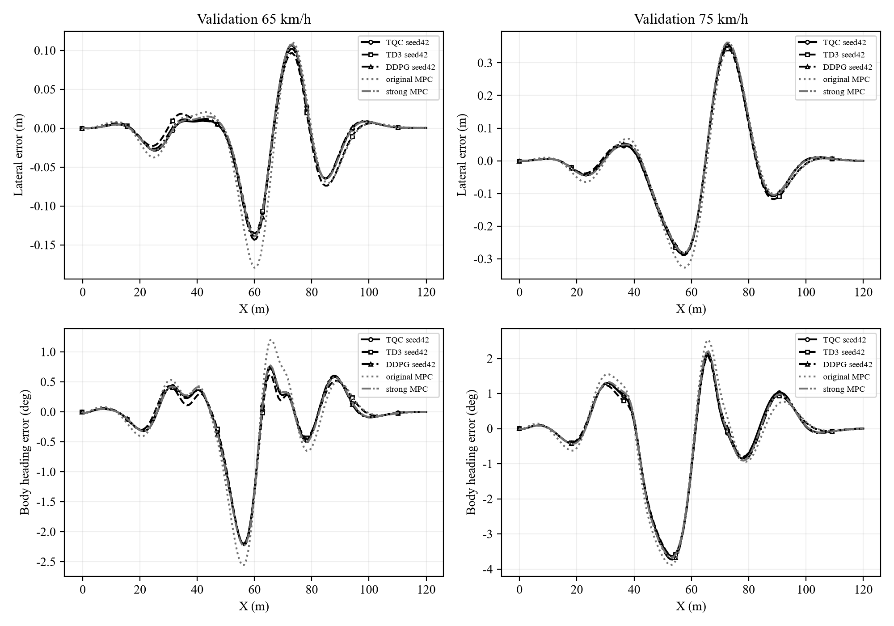

# 版本化工况库上的三算法在线技术预实验

本页实验结果冻结于2026-11-16、来源e83f7fb；2026-11-18结构整理验收见 PROJECT_REFACTOR_AUDIT.md。

本轮使用真实 CarSim 在线闭环，未修改三自由度预测模型、增量式 LTV-MPC、车辆/轮胎物理参数、参考轨迹、网络、奖励或动作空间。TQC 为研究重点，与 TD3、DDPG使用统一数据集及验证规则，不预设排名。本报告是 **seed42、固定参考轨迹、速度变化的开发验证**，不是五种子正式比较，也未运行预留低附着 test 的 DRL 策略。

## 实际运行与数据冻结

- 基准提交：`00a68f8`；本轮从干净工作区开始。
- 数据版本：`datasets/carsim/manifests/dataset_v1.json`。
- 数据哈希：`920bec95afaee29ab441a8ce60cc1f5b11c04bcdb04325f7bf8287debaa5dc9f`。
- train=70/60/80 km/h、μ=0.8，保留有序池和历史 RNG 语义；validation=65/75、μ=0.8；test=70、μ=0.6。旧 `configs/real_scenario_sets.local.json` 未更改。
- 控制配置 `configs/strong_weights3.ini`，训练配置 `configs/rl_training_pilot.ini`。Np=36、Nc=13，动作 Qy/Qpsi/Rdelta，20 维联合观测、联合奖励、连续对数映射、变化率 1.08，MPC 0.04 s、决策 0.08 s。
- 各算法均 seed42、7900 个真实 decision、550 个预热 decision、每 790 个 decision 验证两个开发工况；每步一次梯度更新，共 7350 次。各自随机初始化网络和独立空经验池，没有 resume 或共享经验。
- 真实运行先 TQC，技术完成后依次运行 TD3、DDPG。每个训练输出目录独立，全部周期模型、final、best_legal、验证记录和实际轨迹保留。

实际目录：

```text
runs/dataset_system_20261116_222225/
  acceptance.json
  cases/                        # 从版本 manifest 冻结的六个工况
  switch_probe/                 # 六回合真实零动作工况切换
  parity_0/ parity_1/ parity_2/  # 三训练源全程零动作一致性
  tqc/tqc_v70kmh_100episodes_seed42_20261116_222250/
  td3/td3_v70kmh_100episodes_seed42_20261116_223044/
  ddpg/ddpg_v70kmh_100episodes_seed42_20261116_223402/
  training_execution_audit.json
```

子目录名称中的 `v70kmh_100episodes` 是旧命名接口保留的首源和请求值；真实训练采用三个工况及**精确 7900 decision**，不以此名称判定工况或预算。每算法实际 100 个有样本回合，其中 99 个完整结束，最后一个因预算结束保留 50 个 decision 的部分回合。这不是求解器失败。

## 真正的训练源暴露量

下表对三个算法均相同，本轮实际核对了 episode 日志、样本计数与 Replay Buffer。相同 seed 的有序随机采样在这三次实际运行中产生相同暴露量；一般情形不承诺有限次数内工况等频，也不将 uniform_episode 称为等 decision 采样。

| km/h | 有真实样本回合 | 完整回合 | 实际 decision | 样本占比 |
|---:|---:|---:|---:|---:|
| 70 | 27 | 26 | 2104 | 26.633% |
| 60 | 33 | 33 | 3036 | 38.430% |
| 80 | 40 | 40 | 2760 | 34.937% |
| 每算法 | 100 | 99 | 7900 | 100% |

三算法共采集 23700 个真实 decision，不包括验证、基线、parity 和 reset。各自最终 Replay Buffer=7900，初始=0；validation_used_for_updates=false。六回合切换探针为 70→80→60→60→60→80，共 493 decision、六个不同 Solver 进程，均到达参考终点、QP=0；仅用于接口验收，没有训练。

## 开发验证结果

选择规则保持：完赛、QP=0、Ay≤0.85g、|Beta|≤5°；在每个 validation 工况横向与车身航向 RMSE 均优于该工况强 MPC，才判定全部工况达标。合法检查点按各工况 min(Iy,Iheading) 的最差值选取。final 只诊断，不能代替周期选模。

强 MPC 对照：65 km/h 为 **0.045448 m / 0.612186°**，75 km/h 为 **0.131495 m / 1.296435°**。以下选模只使用 validation，没有读取 test 策略结果。

| 算法 | 最佳合法步数 | 65 km/h：横向 m / 航向 ° | 75 km/h：横向 m / 航向 ° | 全部工况双改善 |
|---|---:|---|---|---|
| TQC | 7110 | 0.045331 / 0.600353 | 0.130949 / 1.273253 | 是 |
| TD3 | 7900 | 0.044201 / 0.590665 | 0.129800 / 1.253589 | 是 |
| DDPG | 2370 | 0.045646 / 0.602643 | 0.129996 / 1.297691 | 否 |

相对对应速度强 MPC 的 Iy/Iheading：

| 算法 | 65 km/h | 75 km/h | 平均 Iy / Iheading | 最差单项改善 |
|---|---|---|---|---:|
| TQC | +0.257% / +1.933% | +0.415% / +1.788% | +0.336% / +1.860% | +0.257% |
| TD3 | +2.743% / +3.515% | +1.289% / +3.305% | +2.016% / +3.410% | +1.289% |
| DDPG | −0.435% / +1.559% | +1.140% / −0.097% | +0.352% / +0.731% | −0.435% |

DDPG 的平均两项改善均为正，但两个工况分别有一项退化，因此双改善工况比例为 0/2，不能标记达标。其 best_legal、全部周期模型和 Pareto 候选仍保留，未生成 best_joint。TQC、TD3 均为 2/2，并保存 best_joint。三算法全部 66 次验证回放（每算法 10×2 周期加 2 次 final）均完赛、QP=0 且通过既定稳定性门槛。

| 算法最佳合法模型 | validation 最大 Ay (m/s²) | 最大绝对 Beta (°) |
|---|---:|---:|
| TQC | 7.246656 | 2.807932 |
| TD3 | 7.268258 | 2.838237 |
| DDPG | 7.267699 | 2.867478 |

原始逐工况峰值、航迹角 RMSE、相对原始 MPC 改善、完整距离及奖励分项等保留于 `pilot_validation_metrics.csv` 和各运行 `joint_validation.csv`，不以平均值掩盖困难工况。

## 最终模型与后期变化

| 算法 final（仅诊断） | 65 km/h：m / ° | 75 km/h：m / ° | 双改善工况比例 |
|---|---|---|---|
| TQC | 0.045592 / 0.601338 | 0.130654 / 1.273970 | 1/2 |
| TD3 | 0.044241 / 0.590506 | 0.130346 / 1.252798 | 2/2 |
| DDPG | 0.048746 / 0.608704 | 0.133621 / 1.294042 | 0/2 |

TQC final 在 65 km/h 横向比强 MPC 差 0.317%，说明保存验证最佳模型仍有必要；不能把 final 的 75 km/h 横向更好替代全部工况规则。DDPG 后期横向退化明显，最差单项改善从最佳合法 −0.435% 变为 final −7.258%。TD3 final 仍双改善，但最差改善从 1.289% 降为 0.873%。

SB3 周期 callback 位于相应 rollout 的梯度更新之前，故第 7900 步周期模型与 final 可相差最后一次梯度更新，其 SHA 和回放指标分别记录。这是两份不同模型，不拼接指标。训练回报由不同速度回合混合，不能直接代替验证双 RMSE，也不能由单个 seed 得出训练稳定性或最终算法排名。

扫描全部实际训练轨迹：TQC/TD3/DDPG 峰值 Ay 分别为 7.332744/7.317761/7.321664 m/s²，峰值 |Beta| 分别为 4.676720/4.794495/4.863811°，没有超出本轮安全门槛的已采集回合。全部训练 QP=0；80 km/h 已接近侧偏门槛，后续仍需逐回合监测，不能据本轮推广到更高速度或低附着。

## 结果文件与图

`datasets/carsim/reports/dataset_v1_seed42_pilot/` 包含：

- dataset_summary.csv、dataset_statistics.json、dataset_manifest.json：版本化工况及三算法合计样本统计；只汇总同 hash 的实际日志。
- pilot_validation_metrics.csv：最佳合法及 final，逐算法、逐工况，含两套基线改善和安全指标。
- pilot_model_locks.json：新运行的最佳合法模型、来源检查点及 SHA。旧 `docs/archive/next_stage_20261116_locks.json` 不变。
- 各算法完整 joint_validation/checkpoint_aggregate/train_monitor CSV。
- training_execution_audit.json：版本、来源、配置、模型/日志 SHA、实际软件版本及计数核对。
- training_safety_audit.json：扫描全部实际训练轨迹的 Ay/Beta 结果。
- dataset_table、decision_exposure、training_curves、checkpoint_validation、checkpoint_pareto、validation_tracking、executed_weights 的 PNG/PDF。英文数字 Times New Roman、中文 SimHei，黑白线型/空心标记可区分。




## 直接复现命令

需本机 CarSim 2024.1 许可/DLL、完整本地工况数据与 Python 依赖；先用 dataset_manager validate 核验。输出使用新的唯一目录。以下不会启动五种子正式训练：

```powershell
$env:OMP_NUM_THREADS='1'
$env:MKL_NUM_THREADS='1'
$env:PYTHONDONTWRITEBYTECODE='1'
python python/dataset_manager.py validate
python python/train.py --algorithm tqc --config configs/strong_weights3.ini --train-config configs/rl_training_pilot.ini --scenario-set datasets/carsim/manifests/dataset_v1.json --episodes 100 --total-decisions 7900 --seed 42 --eval-frequency 790 --joint-selection --training-only --keep-training-traces --parity-blocks 200 --out runs/dataset_v1_tqc_NEW
# TQC 技术成功后，将 algorithm 和 out 分别改为 td3、ddpg；不得 resume。
python python/dataset_manager.py summary --manifest datasets/carsim/manifests/dataset_v1.json --run 'runs/实际TQC输出/实际训练子目录' --run 'runs/实际TD3输出/实际训练子目录' --run 'runs/实际DDPG输出/实际训练子目录' --out datasets/carsim/reports/新统计目录
cmake --build out/python-rl-build --config Release
ctest --test-dir out/python-rl-build -C Release --output-on-failure
uv run --no-project --with-requirements python/requirements.txt --with pytest python -m pytest python/tests -q -p no:cacheprovider
```

训练开关、源采样和验证均复用现有 train.py/CarSimMPCEnv/JointValidator，没有新增训练框架。工况注册、扩展、版本与备份方式见 [DATASET_GUIDE.md](DATASET_GUIDE.md)。

## 验收与下一步

Release 构建通过；CTest 1/1；pytest 80 项通过（新增库、版本、迁移、源数量和真实计数语义测试）。三个训练源全程 zero-action parity 分别检查 157/183/137 个控制步；实际切换验收和三算法共 23700 decision 已完成。六源原始文件 SHA 和既有 12 组固定基线证明完整，历史文件未覆盖。未运行预留 test 的策略评价、未运行五种子正式训练，未更改 MATLAB 工程。

下一步先核查本轮周期验证和后期变化，预先冻结公平的超参数搜索及选择规则，再用相同不可变数据集准备五种子实验。当前是技术预实验完成，并非正式比较条件自动满足；formal_compare 仍要求独立的验证选参锁。不得为了使 TQC 领先而修改评价条件。未来增加真实曲率/变速/附着分段源，必须先注册、完成适用性与真实求解器验收、发布新版本，不能在现有训练版本运行过程中改变集合。
