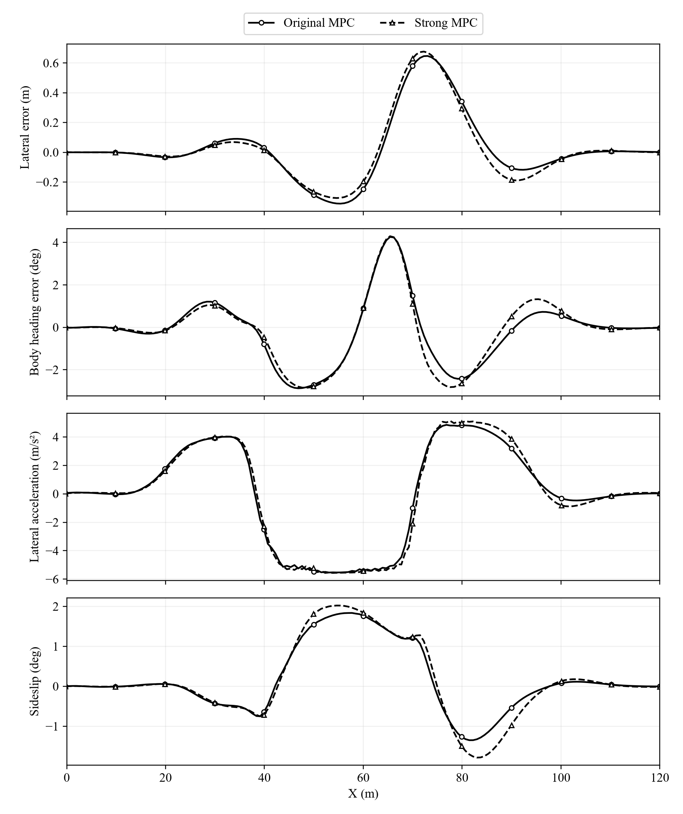

# 70km/h、mu=0.6预留测试工况验收

后续状态：60/.8及80/.8已验收加入train，见[60报告](CarSim_60kmh_Training_Case.md)及[80报告](CarSim_80kmh_Training_Case.md)。下文保留5cd28d8阶段的低附着结果与当时准备状态；test归属和指标未改变。

基于9470d21，2026-11-16。已定位用户提供的真实CarSim 2024.1工况、建立独立源快照并完成固定MPC预检。本轮只做测试源与基线可行性验收，**未评价DDPG/TD3/TQC测试性能、未训练或选模调参**。MPC、车辆、奖励、动作与原模型均未改变。

## 真实来源与冻结

原生Simfile为 `D:\Program Files (x86)\CarSim2024_Date\simfile.sim`，Parsfile为 `D:\Program Files (x86)\CarSim2024_Date\Results\Run_6cb07365-85a3-4a3b-95f9-c5c844687601\Run_all.par`。实际内容为SPEED_TARGET_CONSTANT=70、MU_ROAD_CONSTANT=0.6、横向附着项0。与冻结70/.8逐行比较物理内容，唯一变化是mu从0.8降至0.6。

固定快照文件：

```text
C:\Users\fengchengmin\Desktop\JQRKZ\DRL-MPC\runs\reserved_test_70_mu06_20261116_210820\source_70_mu06\simfile.sim
C:\Users\fengchengmin\Desktop\JQRKZ\DRL-MPC\runs\reserved_test_70_mu06_20261116_210820\source_70_mu06\Run_all.par
```

完整Parsfile SHA256：`5c786ae2233b8edacd5dea4923f23d835a202f9a17213bc5eee5599d093450cd`。

私有Simfile SHA256：`6b791108878521c633411b136badbee39c1859f88ed5e87798d384a39c0b5b24`。

物理工况签名：`37580cac3f141fec7281d15b32610f24ee39dff6f195bb6cb873d2bcbfc257f0`，与70/.8、65/.8、75/.8均不同。车辆、I/O和LTARG哈希与三份已验收源一致，旧快照再次核验完整且未重建。仅凭可变Simfile的名称或其文件哈希不能辨别物理工况，必须同时检查其指向Parsfile的完整内容和签名。

原生echo核对：两路IMP_STEER_L1/IMP_STEER_R1、REPLACE、deg；20路输出顺序与现有契约一致；echo中的速度70km/h、mu=0.6。实际运行plant=carsim，控制周期0.04s、RL决策周期0.08s。完整来源哈希、配置链哈希、I/O、模型锁保护与预留用途见[冻结记录](../archive/heldout_mu06_20261116_lock.json)。

## 双MPC真实预检

权重保持原样：原始40/13/11500/2800/10800，强36/13/18400/8960/10800，track_course=true。使用既有scenario_preflight工具，在同一冻结工况真实闭环回放：

| 指标 | 原始MPC | 强MPC |
|---|---:|---:|
| 横向RMSE m | 0.220111561 | 0.221931646 |
| 车身航向RMSE ° | 1.497700425 | 1.543465749 |
| 横向绝对峰值 m | 0.647481606 | 0.677078594 |
| 航向绝对峰值 ° | 4.263196686 | 4.296609898 |
| 峰值Ay m/s² | 5.533115124 | 5.562694660 |
| 峰值Beta ° | 1.835971005 | 2.021896096 |
| 实际终点X m | 120.002043411 | 120.007314773 |
| QP失败次数 | 0 | 0 |
| 完赛/既定稳定性门槛 | 是/通过 | 是/通过 |

门槛仍为完整结束、QP=0、峰值|Ay|≤0.85g、|Beta|≤5°。没有放宽门槛或改变基线。**稳定性预检通过不等于跟踪精度良好**：两者横向峰值均超过0.64m，强MPC两项RMSE和峰值均略差于原始MPC。这表明70/.8上的静态调优优势不能直接推广到低附着，未来最终报告应保留两套基线，不隐去更好的原始MPC，也不能据此反向优化测试工况参数。

实际质量1513kg。前/后轴侧向力峰值分别约5309/3009N（原始）、5304/3030N（强），投影车体侧向合力峰值约8248/8306N。`peak|Ay|/(mu*g)`约0.940/0.945，`peak|Fy_body|/(mu*m*g)`约0.926/0.933，横向力平衡RMSE约0.0264/0.0312m/s²。整体名义需求指标未超过1，但现有20输出缺少逐轮Fx/Fz，不能把这些整体比值称为完整联合滑移摩擦圆验证。



图仅使用两套固定MPC真实日志，黑白线型/标记区分，英文数字Times New Roman，中文字体配置SimHei。[逐基线完整CSV](../archive/heldout_mu06_20261116_metrics.csv)及本地原生日志均保留。

## 集合与正式训练状态

已将真实私有路径加入 [real_scenario_sets.local.json](../../configs/real_scenario_sets.local.json) 的test。当前为train=[70/.8]、validation=[65/.8,75/.8]、test=[70/.6]；65/75没有转入train。该测试源预先冻结，只可用于最终预锁定策略的测试，禁止参与超参数、模型、奖励、动作或MPC调优。

当前Browser默认入口已经是预留测试源。后续训练必须显式传入正式scenario-set或冻结的训练Simfile；不要使用未指定工况的legacy训练命令，否则其默认入口会指向当前Browser。清单训练入口会取train来源并拒绝清单外的显式训练源。

本轮重新预检四份真实源的8组固定基线，全部通过，`preflight/baseline_proof.json.ready=true`。它仅表示分集及双基线安全证据完整，**不是正式DRL训练已就绪**。formal_compare仍ready=false、executed=false，剩余阻塞为：至少两种真实已验收训练速度、多工况验证选出的超参数配置锁。最小训练扩展仍是60/.8、70/.8、80/.8，60/80需原生生成并验收；只用70不能宣称多工况训练。

测试策略尚未运行，不存在本轮TQC/TD3/DDPG低附着性能或算法排名结论。所有现有模型/检查点和配置继承链哈希保持原锁一致。

完整输出：`runs/reserved_test_70_mu06_20261116_210820/`，含source_70_mu06、source_verification、物理差异、candidate_sets、原集合备份、preflight的8组原始结果、low_mu_metrics、force_feasibility、heldout_case_lock、零动作一致性、formal_plan及基线图PNG/PDF。旧runs和MATLAB工程未动。

检查结果：Release构建通过，CTest 1/1，pytest 69/69；低附着主线零动作一致性全程157步通过。只更新工况集合、验收文档与真实数据，没有修改控制/训练代码。

复现命令（项目根PowerShell，使用未存在的新输出目录，不进行策略测试或训练）：

```powershell
$env:OMP_NUM_THREADS='1'
$env:MKL_NUM_THREADS='1'
$env:PYTHONDONTWRITEBYTECODE='1'
uv run --no-project --with-requirements python/requirements.txt python python/scenario_preflight.py --scenario-set configs/real_scenario_sets.local.json --out runs/all_cases_baseline_NEW
$heldout = (Get-Content configs/real_scenario_sets.local.json -Raw | ConvertFrom-Json).test[0]
uv run --no-project --with-requirements python/requirements.txt python python/parity.py --config configs/strong_weights3.ini --simfile $heldout --blocks 200 --out runs/heldout_parity_NEW
uv run --no-project --with-requirements python/requirements.txt python python/formal_compare.py --profile weights3 --scenario-set configs/real_scenario_sets.local.json --train-config configs/rl_training_pilot.ini --total-decisions 7900 --baseline-proof runs/all_cases_baseline_NEW/baseline_proof.json --out runs/formal_precheck_NEW
```

formal_compare不附--execute；7900仅作为当前预检预算。下一步是补齐60/80真实训练源并冻结多工况选参方案，不因测试基线数据而直接调整控制器或启动15组训练。
