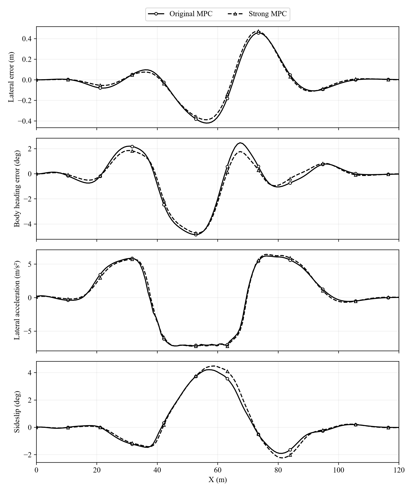

# 80km/h、mu=0.8训练工况验收

基于2b820a7，2026-11-16。当前原生工况已通过契约与真实双MPC预检，冻结后加入train。60/70/80三种训练速度现均有独立真实快照；validation仍为65/75，test仍为70/.6。没有启动训练、resume、重新选模或改变MPC、车辆、奖励、动作及网络。

## 原生来源与独立快照

原生入口为 `D:\Program Files (x86)\CarSim2024_Date\simfile.sim`，对应 `D:\Program Files (x86)\CarSim2024_Date\Results\Run_6cb07365-85a3-4a3b-95f9-c5c844687601\Run_all.par`。实际SPEED_TARGET_CONSTANT=80、MU_ROAD_CONSTANT=0.8，与冻结70/.8比较物理内容，仅速度70→80不同。

私有文件：

```text
C:\Users\fengchengmin\Desktop\JQRKZ\DRL-MPC\runs\training_case_80_mu08_20261116_213738\source_80_mu08\simfile.sim
C:\Users\fengchengmin\Desktop\JQRKZ\DRL-MPC\runs\training_case_80_mu08_20261116_213738\source_80_mu08\Run_all.par
```

完整Parsfile SHA256：`ea37992d365b06157e0a18f71f4b3fdf7336c3be14d3893e7211a47c08c1b7af`。

私有Simfile SHA256：`45f4f03612316b247cefad4b825ce7fb6dcc02ef76bc3b53f024c25026360bf8`。

物理签名：`3666b760495501987d4d2aed740c6bf967efc572ad035d4d2872509ac4ddd39e`，与之前五源均不同。车辆/轮胎、I/O与原120m LTARG哈希一致；原生echo核对两路IMP_STEER_L1/R1、REPLACE、deg，20路输出顺序不变，速度80、mu=.8。控制0.04s、决策0.08s，反馈仍为SI单位。旧五源、模型、检查点与配置链哈希均核验未变。[完整验收记录](../archive/training80_20261116_acceptance.json)保留全部源路径、哈希、echo与切换证据。

## 两套固定MPC真实结果

| 指标 | 原始MPC | 强MPC |
|---|---:|---:|
| 横向RMSE m | 0.188269186 | 0.183736620 |
| 车身航向RMSE ° | 1.846985827 | 1.722894293 |
| 横向峰值 m | 0.456825642 | 0.472391249 |
| 航向峰值 ° | 4.852528822 | 4.719942459 |
| 峰值Ay m/s² | 7.206615575 | 7.260633811 |
| 峰值Beta ° | 4.218194642 | 4.488507937 |
| 实际终点X m | 120.004388282 | 120.009055583 |
| QP失败 / 完赛 / 稳定性门槛 | 0 / 是 / 通过 | 0 / 是 / 通过 |

保持原门槛：完整结束、QP=0、峰值|Ay|≤0.85g、|Beta|≤5°。原始与强MPC参数均未调整。强MPC平均两项误差更低，但横向峰值和峰值Beta更高；其Beta距5°仅约0.5115°，不能把通过源验收等同于任意探索策略都安全。后续功能训练需保留同一安全/合法性判定，不能为通过而调低基线或放宽门槛。

完整[指标CSV](../archive/training80_20261116_metrics.csv)含航迹角RMSE与传感诊断。这些是固定MPC结果，不是新DRL性能结论。



图直接使用真实控制后样本，英文数字Times New Roman，中文字体配置SimHei，原始曲线没有为突出某个控制器而改动。

## 三训练源真实回合切换

[正式已验收清单](../../configs/real_scenario_sets.local.json)的实际顺序为train=[70/.8,60/.8,80/.8]、validation=[65/.8,75/.8]、test=[70/.6]。保留旧train索引顺序，仅追加80，所有源共有相同参考轨迹；不能据此声称道路轨迹泛化。

从该清单直接读取train，单一CarSimMPCEnv以seed42运行6个完整回合：70→80→60→60→60→80。每回合关闭旧Solver、启动新子进程，实际初始速度匹配源，观测20维且有限；全部完赛、QP=0并复现对应强MPC指标。决策数79/69/92/92/92/69，共493；按源70为79、60为276、80为138。均匀回合概率不保证小样本均衡或相同交互步数，实际暴露量如实记录。

这是零动作接口检查：动作0表示强MPC中性参数，转角仍由C++ MPC求解；没有学习器、经验池、梯度更新或策略选模，validation/test未进入该探针。真实多工况DRL训练尚未执行。

6份工况的12组双MPC预检全部通过，baseline_proof.ready=true。formal_compare仍ready=false、executed=false，当前阻塞只剩缺少在开发验证集上选出的超参数配置锁。三速度数据准备已完成，但正式预算、搜索与选模方案仍需冻结，不创建伪造锁文件，也不自动启动15组训练。旧模型锁继续作为历史回放来源，不等同于新多工况选参锁。

## 检查、产物与复现

Release构建、CTest 1/1、pytest 69/69通过；80km/h全程零动作一致性137控制步通过；六回合真实训练源切换通过。本轮只更新工况集合、验收数据和文档，未修改控制/训练代码、历史模型、runs或MATLAB工程。

完整输出 `runs/training_case_80_mu08_20261116_213738/`：source_80_mu08、source_verification、物理差异、原集合备份、preflight的12组回放、training80_metrics、acceptance、neutral_parity、train_switch_probe及其结果、formal_plan和基线PNG/PDF。旧工况快照直接复用，原生Browser入口后续可变化而不影响已冻结源。

项目根PowerShell复现（每次使用未存在的新目录，以下不训练）：

```powershell
$env:OMP_NUM_THREADS='1'
$env:MKL_NUM_THREADS='1'
$env:PYTHONDONTWRITEBYTECODE='1'
uv run --no-project --with-requirements python/requirements.txt python python/scenario_preflight.py --scenario-set configs/real_scenario_sets.local.json --out runs/six_cases_preflight_NEW
$case80 = (Get-Content configs/real_scenario_sets.local.json -Raw | ConvertFrom-Json).train[2]
uv run --no-project --with-requirements python/requirements.txt python python/parity.py --config configs/strong_weights3.ini --simfile $case80 --blocks 200 --out runs/train80_parity_NEW
uv run --no-project --with-requirements python/requirements.txt python python/formal_compare.py --profile weights3 --scenario-set configs/real_scenario_sets.local.json --train-config configs/rl_training_pilot.ini --total-decisions 7900 --baseline-proof runs/six_cases_preflight_NEW/baseline_proof.json --out runs/formal_precheck_NEW
```

下一步是先冻结小规模多工况技术试验与公平选参预算，验证学习器交互/日志和80工况下的策略稳定性，再形成真实验证选出的配置锁；正式多种子比较和预留测试仍在后续阶段。
