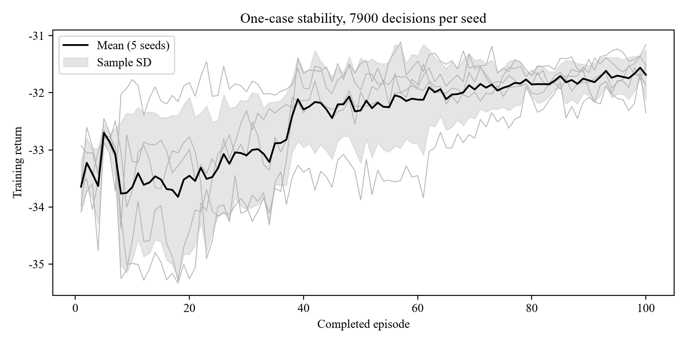
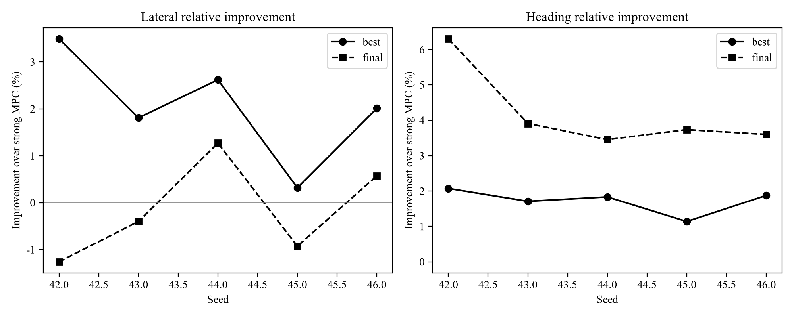

# 一维Qy-only TD3：随机种子稳定性与泛化准备（2026-11-16）

## 范围与冻结协议

任务起点git status为空，HEAD=e0a12e6。主方案仍为strong_qy_only.ini：Np=36、Qpsi=8960、Rdelta=10800、Qy唯一动作、20维road_preview_joint、joint_tracking奖励、连续映射、1.08变化率、0.04 s控制周期和0.08 s决策周期。原配置、旧模型、历史runs和MATLAB保留，未重复清理。

保留seed42原结果，新增seed43–46，每次随机网络、独立空回放池、真实CarSim在线交互7900决策、550预热、每790步确定性评价、100完成回合。六个新run（四种子加两消融）均保留全部训练轨迹、周期检查点、合法/达标最佳、final及优化器CSV。报告脚本核对五种子的算法设计、控制配置哈希、源Parsfile哈希和预算一致，没有只选最好种子。

以下均为70 km/h、μ=0.8、120 m双移线的**同工况稳定性/开发集选择**。周期评价仍使用训练工况，不称独立验证或泛化成功。

## 五种子实测

强MPC为0.07895276 m / 0.91909250°；恒定Qy=20000为0.07783976 m / 0.91419456°。best为每种子按相同规则选出的周期合法检查点；final独立报告。

| Seed | 最佳步数 | best横向RMSE m | best航向RMSE ° | final横向RMSE m | final航向RMSE ° | best超过强/静态 | final超过强/静态 |
|---:|---:|---:|---:|---:|---:|---|---|
| 42 | 4740 | 0.076195 | 0.900024 | 0.079948 | 0.861160 | 是/是 | 否/否 |
| 43 | 4740 | 0.077524 | 0.903371 | 0.079267 | 0.883152 | 是/是 | 否/否 |
| 44 | 3160 | 0.076884 | 0.902230 | 0.077950 | 0.887346 | 是/是 | 是/否 |
| 45 | 5530 | 0.078701 | 0.908605 | 0.079684 | 0.884761 | 是/否 | 否/否 |
| 46 | 7110 | 0.077364 | 0.901846 | 0.078500 | 0.885995 | 是/是 | 是/否 |

| 汇总（样本标准差ddof=1） | best | final |
|---|---|---|
| 横向RMSE均值±SD m | 0.077334 ± 0.000923 | 0.079070 ± 0.000831 |
| 航向RMSE均值±SD ° | 0.903215 ± 0.003244 | 0.880483 ± 0.010912 |
| 相对强MPC平均 Iy / Iheading | +2.05% / +1.73% | −0.15% / +4.20% |
| 强MPC双指标达标比例 | **5/5** | **2/5** |
| Qy=20000双指标达标比例 | **4/5** | **0/5** |
| 所列best/final未完成或安全/QP失败比例 | 0/5 | 0/5 |

所有所列模型QP失败为0，峰值Ay为7.0726–7.1258 m/s²、Beta为1.9844–2.1081°。全量逐种子峰值、改善率和合法性在per_seed_metrics.csv；每个run的joint_validation.csv还保留所有周期检查点，不能用表中的筛选模型代表未经选择的随机训练结果。

结论是“同工况中能重复找到小幅双改善检查点”，而非最终训练收敛稳定。五个最终模型相对各自best都增加横向RMSE，航向继续降低；只看训练回报提升会掩盖双指标失守。

各seed的10个周期检查点中，强MPC双改善数分别为7、4、5、1、7，总计24/50。seed45只有一次周期达标，进一步说明“5/5能选到”不能写成“整个训练过程稳定达标”。

## 独立单因素消融（seed42）

新增td3_qy_actor_lr1e4.ini仅改变TD3 Actor LR；td3_qy_sigma010.ini仅改变TD3 sigma。测试核对每份配置恰好一个有效训练参数变化，Critic仍3e-4，奖励、动作、车辆与网络均不变。每组从头7900决策。

| 方案 | Actor LR / sigma | best步数 | best RMSE m / ° | final RMSE m / ° | final强/静态双改善 |
|---|---|---:|---|---|---|
| 原方案 | 3e-4 / 0.15 | 4740 | 0.076195 / 0.900024 | 0.079948 / 0.861160 | 否/否 |
| A | 1e-4 / 0.15 | 5530 | 0.077220 / 0.897232 | 0.079088 / 0.877451 | 否/否 |
| B | 3e-4 / 0.10 | 7900 | 0.075904 / 0.897511 | 0.076000 / 0.896626 | **是/是** |

降低Actor LR稍减轻最终横向退化，但没有解决达标问题，不据此继续盲目调低。降低sigma在该种子上使7900步末端仍双改善；final相对强MPC为+3.74%/+2.44%，相对Qy=20000为+2.36%/+1.92%。这只是一个种子的消融，不直接替换主方案，也不作为算法排序依据。下一步可在独立验证来源就绪后，原样补sigma0.10的43–46种子，保持其余因素不变。

原方案确定性检查点回报从790步−31.880提高到7900步−31.161，但min(Iy,Iheading)从−0.23%变成−1.35%；LR消融也存在回报提高而双指标失守。sigma0.10回报从−32.256提高到−31.079，最差相对改善从+0.39%到+2.35%。reward_alignment.csv与reward_vs_dual_improvement图并列展示，避免将标量回报当作双指标证明。

## 动态Qy优势的真实闭环对照

使用seed42 best_legal冻结模型，所有对照重新运行真实CarSim。模型、来源哈希和新回放轨迹在runs/qy_mechanism_20261116_v2。

| 控制方式 | 横向RMSE m | 航向RMSE ° |
|---|---:|---:|
| 原始MPC | 0.087240 | 1.014074 |
| 强MPC（Qy=18400） | 0.078953 | 0.919092 |
| 开发集优化恒定Qy=20000 | 0.077840 | 0.914195 |
| 动态执行Qy均值20542.4074对应的恒定Qy | 0.077348 | 0.923614 |
| 冻结Qy(X)位置调度 | **0.076195** | **0.900024** |
| 当前车辆状态反馈TD3 | **0.076195** | **0.900024** |

位置表在新反馈回放后固定，以每次决策开始的X与实际执行Qy构造，之后的调度回放不调用策略、不读取ey/heading；仅由当前X查表并经过相同有界逆映射和1.08变化率限制。没有修改已有CSV来模拟车辆结果。v1曾遇到权重上限2e-11量级浮点越界，修复仅容纳数值舍入后另建v2，失败目录保留。

反馈策略优于平均常量与Qy=20000，说明这条轨迹的权重随位置变化有价值；但固定位置调度精确复现其结果，因此**尚未证明车辆状态反馈具有额外收益**。这是同工况确定性轨迹可被位置表复现的证据，不是泛化证明。原7点恒定扫描也全部重跑；Qy=23920仍有更低横向0.075079 m、但航向0.936555°更差，保留静态Pareto权衡。没有在最终测试集重调参数或构造调度表。

## 真实多工况审计

扫描历史非回合内Simfile共165份：现有物理签名去重后56种内容，3份引用不可读。55种候选车辆内容与当前一致，但只有当前70 km/h工况同时满足当前I/O契约；旧60/80等工况的I/O内容不同，不能直接当成相同实验条件的新数据。明细在runs/qy_case_discovery_20261116_v1/candidate_contracts.csv，历史文件未修改。

实际检查的旧60/80来源为3输入/15输出，包含额外IMP_STEER_SW，输出缺少当前Beta/Ay等测量，与当前2输入/20输出存在实质差异，不是仅因文件哈希不同而排除。

scenario_sets现在记录原Simfile/Parsfile哈希、去注释数值化的工况签名、车辆内容哈希、I/O哈希、完整LTARG及数值哈希、附着描述/表、参考站点范围和有限差分曲率峰值。冻结集合要求车辆与I/O内容一致；相同速度/车辆/I/O/轨迹/附着的语义签名跨集合拒绝，重命名、注释或70与70.0等数值格式不能伪造独立性。该规则保守，不替代CarSim导出与人工核验。

没有新增、编辑或伪造物理Simfile。仅将当前真实工况重新冻结并回放双MPC，均完赛、QP零失败且稳定性合格，记录在runs/qy_scenario_preflight_20261116_v2。validation/test为空，所以baseline_proof.ready=false表示集合不完整，并非这次双MPC求解失败。未运行真实多工况训练或独立最终测试。

待生成清单见configs/real_scenario_generation_plan.json，它是设计文档，null Simfile不能传入训练：训练60/70/80及曲率A/B，验证65/75及曲率C，预先锁定测试68/72及曲率D、μ=0.75等候选。实际参数须在CarSim确认可完成和物理稳定后才登记；设计标签A/B/C/D必须对应实际不同曲率内容。

在CarSim Browser复制当前Run Control到新数据集，不改原数据集；保持车辆、轮胎、转向模式，导出真实完整Simfile和Run_all.par。输入必须为IMP_STEER_L1/IMP_STEER_R1、Replace、角度单位；输出保持Xcg_TM、Ycg_TM、Vx、Vy、Yaw、AVz、Ax、Ay、Steer_L1、Steer_R1、Beta、Rho_Road、四轮AlphL和四轮Fy，共20路，顺序与当前导出一致。桥接按SI读取状态，角度导入使用既有弧度到度增益；用Solver echo核对单位、2/20通道数、LTARG、速度、附着和车辆哈希。逐工况运行scenario_preflight，先看双基线完赛、QP、Ay≤0.85g、Beta≤5°，再冻结分集。不得把历史I/O不同文件简单改名或手工补输出后声称已经真实验证。

## 验证统计与正式启动条件

joint_validation保留每工况严格双改善规则及最差改善排序，并新增平均相对改善、最差工况改善、双改善工况比例、合法工况比例；所有检查点记录均可查看。合法Pareto按所有工况的双RMSE向量判断，不只用平均值隐藏困难工况。部分工况通过不等于全部通过。测试集不参与选择。

当前正式DDPG/TD3/TQC **不具备启动条件**：缺独立且兼容的验证/测试真实来源，未锁定公平验证选参结果，也尚未证明状态反馈额外收益。formal_compare默认已改为strong_qy_only.ini，仅生成计划和阻塞预检；未执行15组正式训练。详见EXPERIMENT_GUIDE.md。

## 论文图表与原始数据

统一输出目录runs/qy_stability_report_20261116_v2：per_seed_metrics.csv、seed_summary.csv、ablation_metrics.csv、reward_alignment.csv、run_provenance.json。各run保存训练回报、Actor/Critic日志、checkpoint_aggregate_metrics.csv、joint_validation.csv及完整CarSim轨迹；旧seed42原文件未改写。

图采用Times New Roman（英文/数字）和SimHei黑体回退（中文），纯黑/灰、不同线型与标记，PNG及嵌入字体PDF同时输出。包含训练回报均值±样本SD、各seed误差/Qy随X、Pareto、逐seed改善率、best/final、优化器损失和回报对双指标对齐；机制对照也有黑白曲线。没有合格跨速度/附着/曲率DRL数据，所以不虚构对应泛化图。figure_manifest.json明确记录缺失项。

随Git保留的摘要：[逐种子指标](../archive/qy_stability_20261116_per_seed_metrics.csv)、[均值与标准差](../archive/qy_stability_20261116_seed_summary.csv)、[单因素消融](../archive/qy_stability_20261116_ablation_metrics.csv)。完整模型和轨迹按.gitignore留在本机。





## 可直接运行的命令

```powershell
$env:OMP_NUM_THREADS='1'; $env:MKL_NUM_THREADS='1'; $env:PYTHONDONTWRITEBYTECODE='1'
# 用新输出目录复现单个种子；43替换为44/45/46
python python/train.py --algorithm td3 --config configs/strong_qy_only.ini --fixed-config configs/default.ini --train-config configs/rl_training_pilot.ini --simfile runs/fixed_np_strong_qy_only_7900_20261116_v1/td3_v70kmh_100episodes_seed42_20261116_153408/source_case/simfile.sim --seed 43 --episodes 100 --total-decisions 7900 --eval-frequency 790 --joint-selection --training-only --keep-training-traces --out runs/qy_seed43_NEW
# LR或噪声分别使用对应配置，不resume；其余参数同上
# --train-config configs/td3_qy_actor_lr1e4.ini 或 configs/td3_qy_sigma010.ini，seed42
python python/qy_mechanism.py --run runs/fixed_np_strong_qy_only_7900_20261116_v1/td3_v70kmh_100episodes_seed42_20261116_153408 --out runs/mechanism_NEW
# 有真实工况后：sets.json的train/validation/test值为已存在的Simfile路径列表
python python/scenario_preflight.py --scenario-set sets.json --out runs/scenario_preflight_NEW
python python/train.py --algorithm td3 --config configs/strong_qy_only.ini --scenario-set sets.json --simfile <训练集首工况.sim> --total-decisions 7900 --eval-frequency 790 --joint-selection --training-only --keep-training-traces --out runs/multicase_NEW
```

本机实际使用uv run --no-project --with-requirements python/requirements.txt运行，保留版本化输出目录。Release构建、CTest 1/1、pytest 46/46通过；真实全程157步零动作parity及新种子模型/低噪声最终模型回放通过。没有修改控制器结构、车辆、MATLAB或主方案默认超参数。六个新实验均已实际完成。
